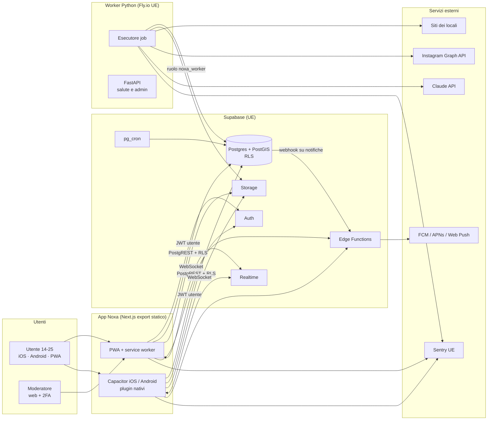
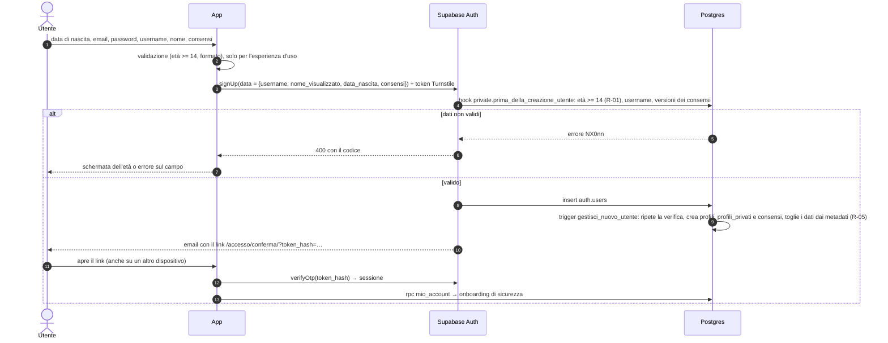
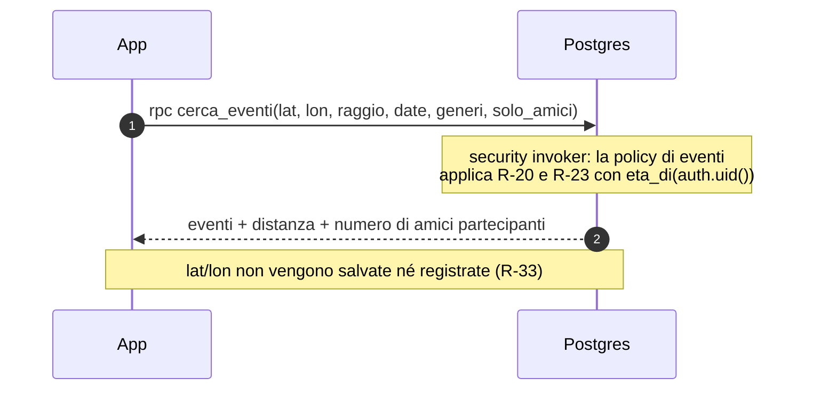
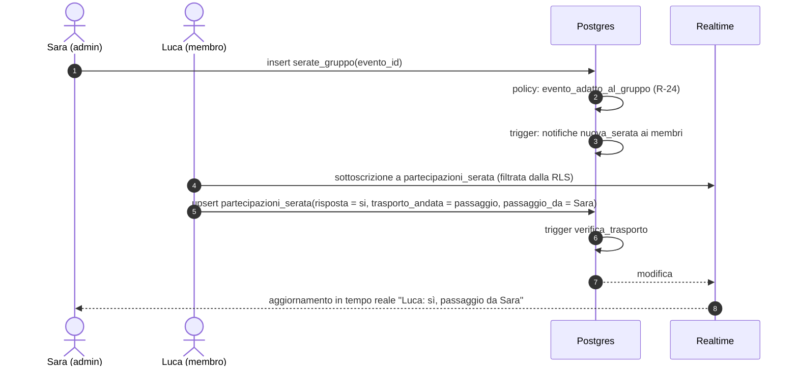
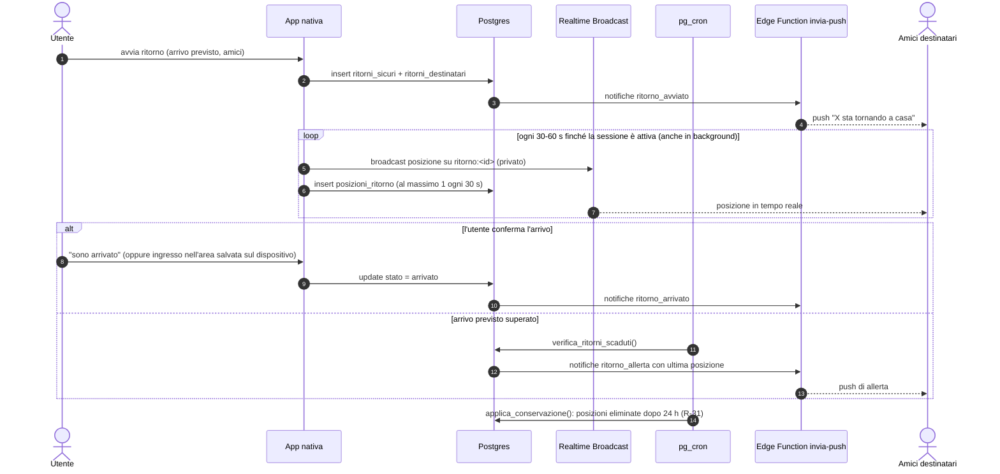
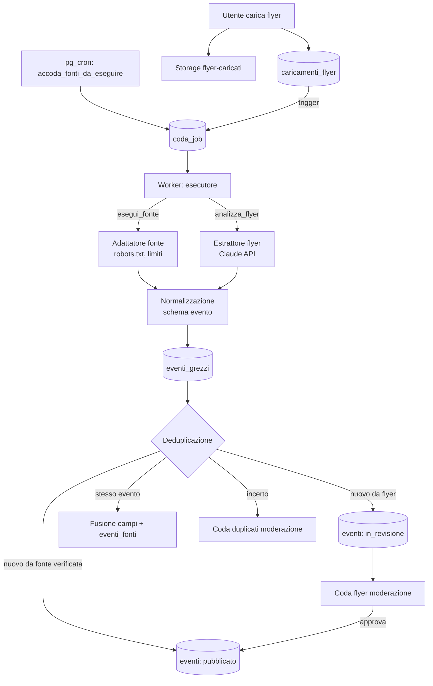
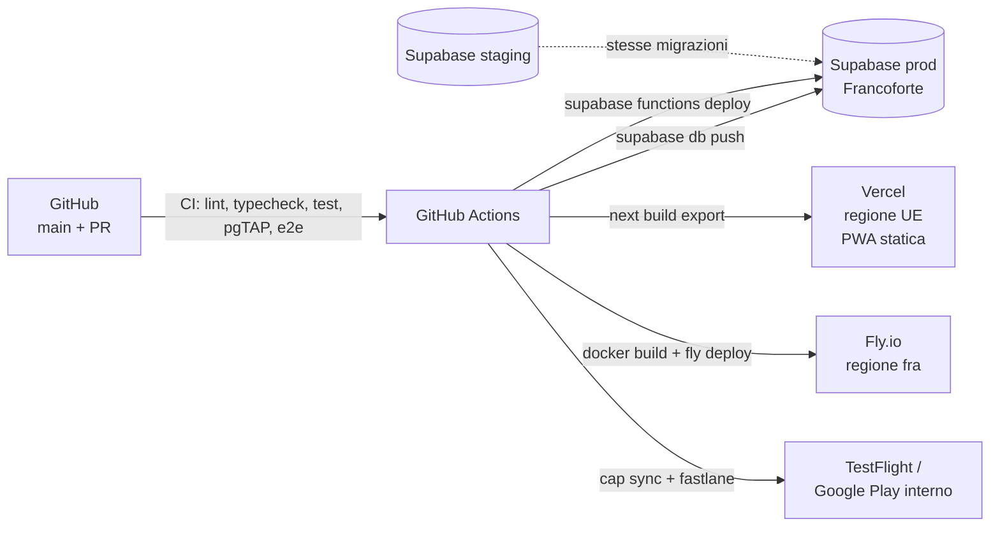

# Architettura

## 1. Panoramica

Noxa è composta da tre blocchi:

1. **App client**: un solo codice Next.js + TypeScript + Tailwind compilato come **export
   statico**, distribuito come PWA sul web e come app iOS e Android tramite Capacitor
   (ADR-0001).
2. **Backend Supabase** (regione UE, ADR-0002, ADR-0012): Postgres + PostGIS con Row Level
   Security come unico punto di autorizzazione, Auth, Storage, Realtime, Edge Functions e
   `pg_cron`. Badge e riepiloghi annuali sono calcolati da funzioni SQL nel database, così i
   dati del tracker non escono mai da Postgres.
3. **Worker** Python (FastAPI + Playwright, in Docker) per raccolta eventi, analisi dei flyer
   e deduplicazione (ADR-0003).

Non esiste un backend applicativo proprio tra app e database: l'app parla direttamente con
Supabase usando la chiave pubblica `anon` e il JWT dell'utente; ogni accesso è filtrato
dalla RLS. La logica che non può stare in una policy si trova in funzioni SQL (RPC), in
Edge Functions (per i segreti di terze parti) o nel worker (per i lavori lunghi).

## 2. Diagramma di contesto

## 3. Componenti

### 3.1 App client (`apps/web`)

| Aspetto | Scelta |
|---|---|
| Framework | Next.js (App Router) con `output: 'export'`: niente rendering lato server, Route Handlers o Server Actions (ADR-0001). |
| Routing | Route statiche; i dettagli usano parametri di query (`/evento?id=…`, `/gruppo?id=…`) perché l'export statico non genera pagine per identificativi dinamici. Il service worker ignora i parametri quando cerca una pagina nella cache. Le aree richiedono un account: senza sessione l'app porta al Benvenuto (R-07). |
| Dati | `@supabase/supabase-js` con tipi generati (`src/lib/database.types.ts`); TanStack Query per cache, retry e stato offline; validazione dei dati in ingresso e uscita con Zod. |
| Stile | Tailwind con design token generati da Claude Design (ADR-0011, [DESIGN.md](DESIGN.md)). |
| Mappe | MapLibre GL JS con la basemap Protomaps (stili `dark` e `light` personalizzati con i design token) in un file PMTiles servito, insieme a font e icone, dal bucket `mappe`: nessuna richiesta a servizi di mappe esterni (ADR-0016). |
| Nativo | Capacitor: geolocalizzazione in background (D-04), notifiche push, fotocamera, condivisione, preferenze sicure per l'area di arrivo (R-32). |
| PWA | Manifest e service worker (Workbox): cache dell'app shell e dei dati in sola lettura (PRD §5 Offline). |
| Organizzazione | `src/features/<area>/` (scopri, organizza, vivi, ricorda, account, moderazione) con componenti, hook, query e test della funzionalità; `src/components/ui` per i componenti del design system. |

### 3.2 Supabase

| Servizio | Uso |
|---|---|
| Postgres + PostGIS | Tutte le tabelle di [DATA_MODEL.md](DATA_MODEL.md) e le RPC elencate in DATA_MODEL.md §5.10 (ricerca eventi e utenti, codici invito, moderazione, metriche). |
| Auth | Email e password (almeno 10 caratteri) con verifica, CAPTCHA (Cloudflare Turnstile, ADR-0020), protezione dalle password compromesse, MFA TOTP obbligatoria per i moderatori (R-06); hook "before user created" per il controllo dell'età (§4.1); modelli delle email in italiano. |
| Storage | Bucket `avatar`, `flyer-caricati`, `flyer-pubblicati`, `immagini-locali` (foto dei locali, ADR-0018), `mappe` (DATA_MODEL.md §6). |
| Realtime | Postgres Changes per serate di gruppo e notifiche; Broadcast privato per le posizioni del ritorno sicuro. |
| Edge Functions (Deno) | `invia-push` (FCM HTTP v1 per Android e iOS, Web Push VAPID), `esporta-dati`, `elimina-account`. |
| `pg_cron` | Job di DATA_MODEL.md §8, compresi il calcolo dei badge e dei riepiloghi annuali con funzioni SQL. |

### 3.3 Worker (`services/worker`)

| Modulo | Responsabilità |
|---|---|
| `coda` | Prelievo dei job con `select … for update skip locked`, lease (`bloccato_fino`, 10 minuti), recupero dei job con lease scaduto, retry con backoff esponenziale (massimo 5 tentativi), idempotenza per `tipo` + chiave del payload. L'esecutore (`EsecutoreCoda`) accede alla tabella tramite il protocollo `ArchivioJob`, verificabile senza database e sostituibile se la coda dovesse uscire da Postgres. Il worker non pianifica nulla: l'unico scheduler è `pg_cron` (ADR-0003). |
| `fonti` | Adattatori, uno per tipo di fonte, con un'interfaccia comune (EVENT_INGESTION.md §4); controllo di robots.txt; limitazione della frequenza per dominio. |
| `flyer` | Prompt, schema Pydantic ed estrazione con Claude API (ADR-0007). |
| `normalizzazione` | Conversione nel formato di `packages/schemas/evento.schema.json`, risoluzione del locale, normalizzazione di date e generi. |
| `dedup` | Normalizzazione dei titoli, confronto fuzzy con rapidfuzz, fusione (ADR-0009). |
| `api` | FastAPI con i soli endpoint interni `GET /salute` (liveness) e `GET /pronto` (readiness: database raggiungibile), usati dai controlli di Fly.io; il worker non è raggiungibile da internet. I comandi di amministrazione (per esempio "esegui ora una fonte") passano da RPC che inseriscono job in `coda_job`. Nel lifespan dell'applicazione avvia `CODA_CONCORRENZA` esecutori della coda. |
| `osservabilita` | Log JSON strutturati (structlog), Sentry, metriche per job. |

Il worker accede a Postgres con il ruolo `noxa_worker` (permessi limitati, senza
`BYPASSRLS`) e usa la chiave `service_role` **solo** nel client Storage per leggere
`flyer-caricati` e scrivere in `flyer-pubblicati` (ADR-0003).

## 4. Flussi dei dati

### 4.1 Registrazione con età

- Il codice di errore dell'hook (`NX001`…`NX006`) arriva all'app nel messaggio della risposta
  e diventa un errore di dominio (`src/lib/errori.ts`). Il trigger ripete la verifica per gli
  utenti creati con `service_role` o se l'hook non fosse configurato.
- Un'email già registrata riceve la stessa risposta di una registrazione riuscita ("Controlla la
  posta") e nessun secondo account viene creato: come il recupero della password, la
  registrazione non rivela chi ha un account.
- Lo username si verifica all'invio, non mentre si scrive: senza account non esiste un modo
  per interrogare i profili (R-07, R-10). Se è già in uso, l'app torna al passo 3 con una
  proposta.
- Le email usano modelli in italiano (`supabase/templates/`) con il link alla pagina dell'app
  che verifica il `token_hash`: la sessione nasce sul dispositivo che apre il link.
- Gli account mai confermati sono eliminati dopo 24 ore (`private.elimina_account_non_confermati`,
  DATA_MODEL.md §8), così lo username torna libero.
- Accesso, recupero e reinvio dell'email passano dallo stesso Turnstile (ADR-0020); dopo il
  recupero della password l'app chiude le sessioni sugli altri dispositivi.

### 4.2 Ricerca eventi

### 4.3 Serata di gruppo in tempo reale

### 4.4 Ritorno sicuro

### 4.5 Raccolta eventi e flyer

Il dettaglio è in [EVENT_INGESTION.md](EVENT_INGESTION.md).

## 5. Dettagli trasversali

### 5.1 Autorizzazione

- Tutta l'autorizzazione è nella RLS e nelle funzioni `private.*` (DATA_MODEL.md §4).
- Le RPC che devono vedere più dati di quelli permessi all'utente (per esempio
  `cerca_utenti`) sono `security definer` in `public`, con filtri espliciti e test dedicati.
- Le Edge Functions verificano il JWT dell'utente e usano `service_role` solo per le
  operazioni documentate (eliminazione dell'account, invio delle notifiche).

### 5.2 Gestione degli errori

- App: ogni chiamata passa da un client tipizzato che converte gli errori di Supabase in
  errori di dominio (`ErroreRete`, `ErroreAutorizzazione`, `ErroreValidazione`,
  `ErroreLimite`, `ErroreSconosciuto`), mostrati con messaggi in italiano e un'azione
  possibile. Error boundary per ogni area. Retry automatico solo per le letture idempotenti.
- Database: le eccezioni dei trigger usano codici `SQLSTATE` personalizzati (`NX001`…) mappati
  in `apps/web/src/lib/errori.ts` e documentati nella migrazione che li introduce.
- Worker: eccezioni tipizzate (`ErroreFonte`, `ErroreConformita`, `ErroreEstrazione`,
  `ErroreValidazione`); ogni job registra l'esito e un errore non recuperabile non viene
  ritentato.

### 5.3 Realtime

- Postgres Changes solo su tabelle con RLS e con filtri per l'identificativo dell'oggetto
  (`serata_id=eq.<id>`), per limitare il carico.
- Le posizioni del ritorno sicuro usano Broadcast privato perché sono ad alta frequenza e non
  devono passare dalla replica delle modifiche.

### 5.4 Notifiche

Le notifiche sono righe in `notifiche` create da trigger e funzioni. Un webhook del database
sull'`INSERT` invoca `invia-push`, che legge `dispositivi_push` e invia il messaggio con un
testo di sistema localizzato, senza testi scritti da altri utenti, poi imposta
`inviata_push_il`. Nella Fase 1 le notifiche sono mostrate solo nell'app tramite Realtime.

### 5.5 Offline

Il service worker conserva l'app shell. TanStack Query salva in IndexedDB le query in sola
lettura (eventi già visti, serate di gruppo proprie, tracker). Le scritture del tracker sono
messe in coda e inviate al ritorno della connessione; le altre scritture richiedono la rete
e lo comunicano all'utente.

## 6. Deployment

- Ambienti: `locale` (Supabase CLI + docker-compose), `staging`, `produzione`, ognuno con un
  progetto Supabase separato.
- Le migrazioni si applicano prima a staging, poi a produzione, solo dalla CI.
- I segreti stanno nel gestore dei segreti di ciascun fornitore; `.env.example` elenca i nomi.
- Backup: Point-in-Time Recovery di Supabase in produzione.

## 7. Scalabilità

| Area | Strategia |
|---|---|
| Letture degli eventi | Indici su `data_serata` e GiST su `locali.posizione`; RPC con limite di pagina; cache lato client. Le funzioni `private.*` sono `stable` e chiamate con `(select …)` nelle policy per sfruttare la cache dei piani. |
| Policy RLS | Funzioni sugli indici (`amicizie` con indice sulla coppia, `membri_gruppo` sulla PK); test di carico sulle query principali con 100.000 utenti sintetici prima della Fase 2. |
| Worker | Più istanze dell'esecutore in parallelo grazie a `skip locked`; la pianificazione resta in `pg_cron`, quindi aggiungere istanze non duplica i job; limite di concorrenza per dominio condiviso tramite la tabella `coda_job` (un solo job `esegui_fonte` in esecuzione per dominio). |
| Realtime | Canali per oggetto; Broadcast per le posizioni. |
| Costi del modello | Una sola chiamata per flyer; deduplicazione tramite hash dell'immagine prima della chiamata; budget giornaliero configurabile (`FLYER_BUDGET_GIORNALIERO_EUR`) oltre il quale i job restano in coda. |
| Nuove aree | `locali.provincia` e il bootstrap dei locali sono parametrizzati (F-46). |

## 8. Osservabilità

- Sentry (regione UE) per app e worker, con `beforeSend` che rimuove email, coordinate e testi
  liberi (R-62).
- Log JSON del worker con `job_id`, `tipo`, `fonte_id`, durata ed esito; mai payload
  personali o coordinate.
- Le RPC non registrano i parametri di posizione (R-33); i log di PostgREST in produzione
  sono configurati per non includere il corpo delle richieste.
- Metriche di prodotto: viste SQL aggregate (`metriche_settimanali`) lette dalla dashboard di
  amministrazione, senza strumenti di tracciamento di terze parti (ADR-0014).
- Allarmi: errori del worker oltre una soglia, fonte disattivata automaticamente, coda della
  moderazione oltre i tempi di R-53, budget dei flyer esaurito.

## 9. Sicurezza applicativa

- Content Security Policy rigorosa per la PWA e le app native: dopo la build
  `scripts/applica-csp.mjs` inserisce in ogni pagina un `<meta http-equiv>` con gli hash
  SHA-256 degli script inline (niente `'unsafe-inline'` né `'unsafe-eval'` per gli script);
  le connessioni sono ammesse solo verso l'app e Supabase, script e iframe esterni solo da
  Cloudflare Turnstile (ADR-0020). Gli attributi `style` di React richiedono
  `'unsafe-inline'` negli stili. `apps/web/vercel.json` aggiunge gli header che un meta non
  può esprimere (`frame-ancestors`, HSTS, `X-Content-Type-Options`, `Permissions-Policy`).
  Sentry, quando arriverà (ADR-0014), sarà l'unica altra origine esterna.
- Dipendenze controllate con Dependabot e `pnpm audit` / `pip-audit` in CI.
- Le chiavi pubbliche (`anon`) sono le uniche nel client; tutto il resto sta solo nel worker e
  nelle Edge Functions.
- Penetration test esterno e DPIA prima della Fase 2 (ROADMAP.md).

## 10. Copertura delle funzionalità

Componenti e flussi coinvolti da ogni funzionalità del [PRD](PRD.md). Le tabelle sono in
[DATA_MODEL.md](DATA_MODEL.md), dove ogni tabella indica le funzionalità che la usano.

| Funzionalità | Componenti | Flusso o sezione |
|---|---|---|
| F-01 Elenco eventi con filtri | App (`features/scopri`), RPC `cerca_eventi` | §4.2 |
| F-02 Mappa | App (MapLibre + Protomaps), bucket `mappe` | §3.1, §4.2, ADR-0016 |
| F-03 Dettaglio evento | App (`/evento?id=`) | §3.1 |
| F-04 Amici che partecipano | RPC `cerca_eventi` (conteggio amici) | §4.2 |
| F-05 Interessato / Partecipo | App, PostgREST | §3.2 |
| F-06 Caricamento flyer | App (fotocamera Capacitor), Storage, worker `flyer`, Claude API | §4.5, EVENT_INGESTION.md §5 |
| F-07 Aggregatori | Worker `fonti` (nuovi adattatori) | §4.5, ADR-0008 |
| F-10 Registrazione e profilo | App, Supabase Auth (CAPTCHA), trigger di registrazione | §4.1 |
| F-11 Amicizie | App, RPC `cerca_utenti`, `crea_codice_invito`, `usa_codice_invito` | §3.2, §5.1 |
| F-12 Blocco e segnalazione | App, area di moderazione | §3.2 |
| F-13 Gruppi | App, policy con `private.puo_entrare_nel_gruppo` | §5.1 |
| F-14 Serata di gruppo | App, Realtime Postgres Changes | §4.3 |
| F-15 Prevendite e liste | App (link esterni) | §4.3 |
| F-16 Trasporto | App, trigger `verifica_trasporto` | §4.3 |
| F-17 Accesso con Apple e Google | Supabase Auth (provider OAuth) | §3.2 |
| F-20 Check-in | App, Realtime | §5.3 |
| F-21 Ritorno sicuro | App nativa (posizione in background), Realtime Broadcast, `pg_cron`, `invia-push` | §4.4, ADR-0006 |
| F-22 Notifiche push | Edge Function `invia-push`, FCM/APNs, Web Push | §5.4 |
| F-30 Tracker | App (offline con coda di scritture) | §5.5 |
| F-31 Statistiche | Vista `statistiche_personali` | §3.2 |
| F-32 Badge | Funzione SQL `private.assegna_badge()` con `pg_cron` | §3.2 |
| F-33 Wrapped | Funzione SQL `private.genera_riepiloghi()` con `pg_cron`, App (immagine generata sul dispositivo) | §3.2 |
| F-40 Moderazione | App (area di moderazione, MFA), RPC di moderazione | §5.1, SAFETY_PRIVACY.md §11 |
| F-41 Diritti privacy | Edge Functions `esporta-dati`, `elimina-account` | §3.2 |
| F-42 Impostazioni di privacy | App | §3.1 |
| F-43 App installabile | Export statico, service worker, Capacitor, store | §3.1, §6, ADR-0001 |
| F-44 Raccolta eventi | Worker (`coda`, `fonti`, `normalizzazione`, `dedup`), `pg_cron` | §4.5, EVENT_INGESTION.md |
| F-45 Accessibilità | App, CI (axe) | DESIGN.md §4 |
| F-46 Nuove aree | Worker (bootstrap dei locali), migrazione su `locali.provincia` | §7 |

