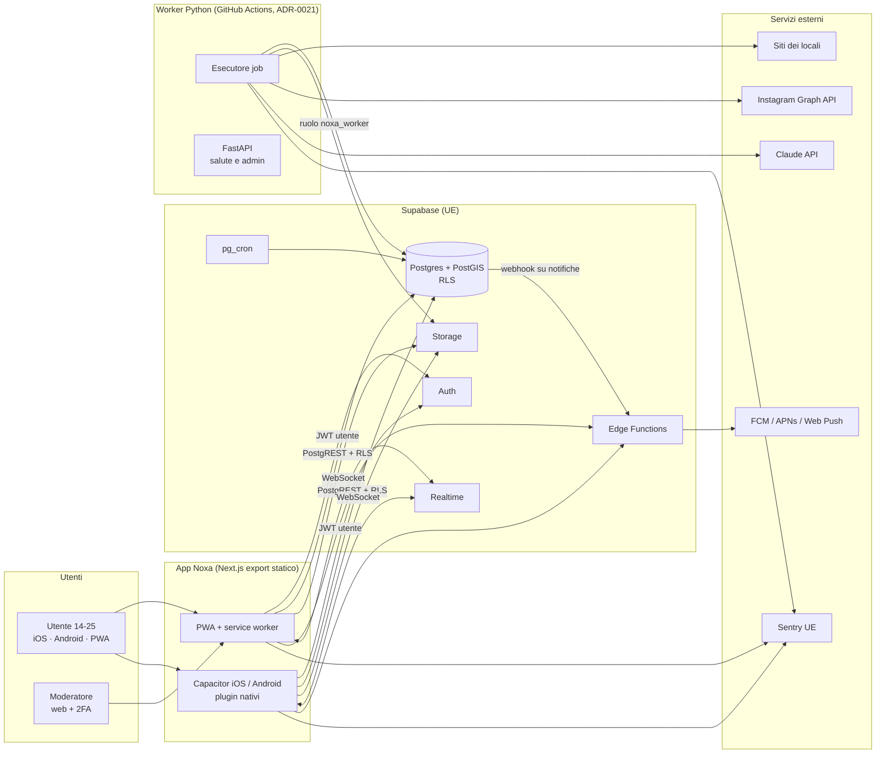
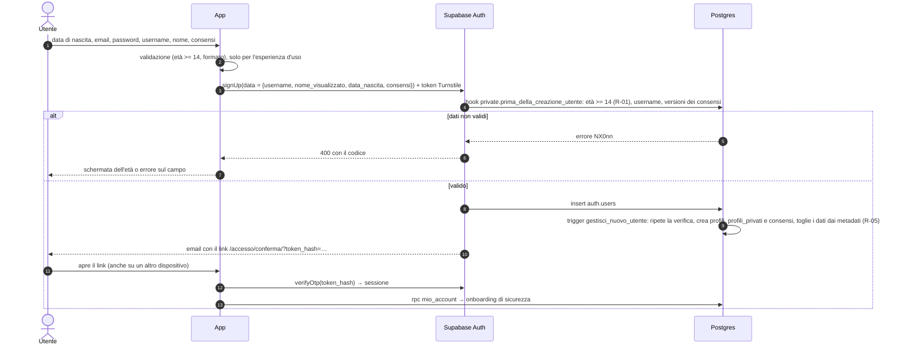
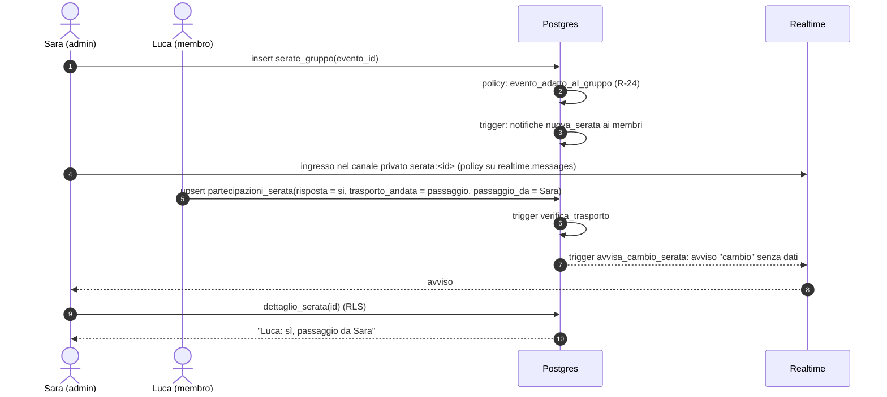
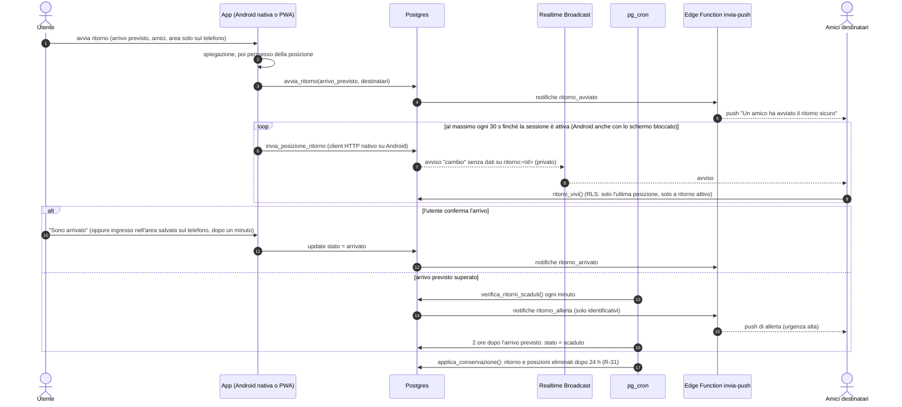
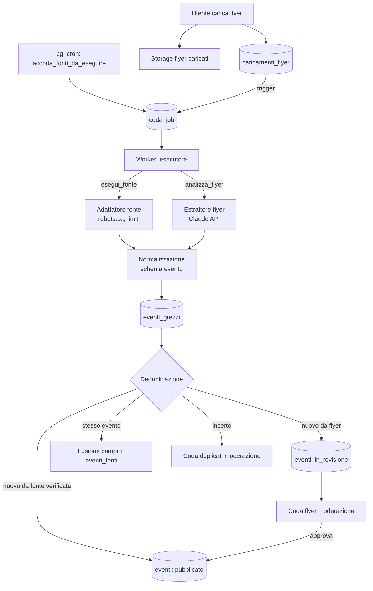
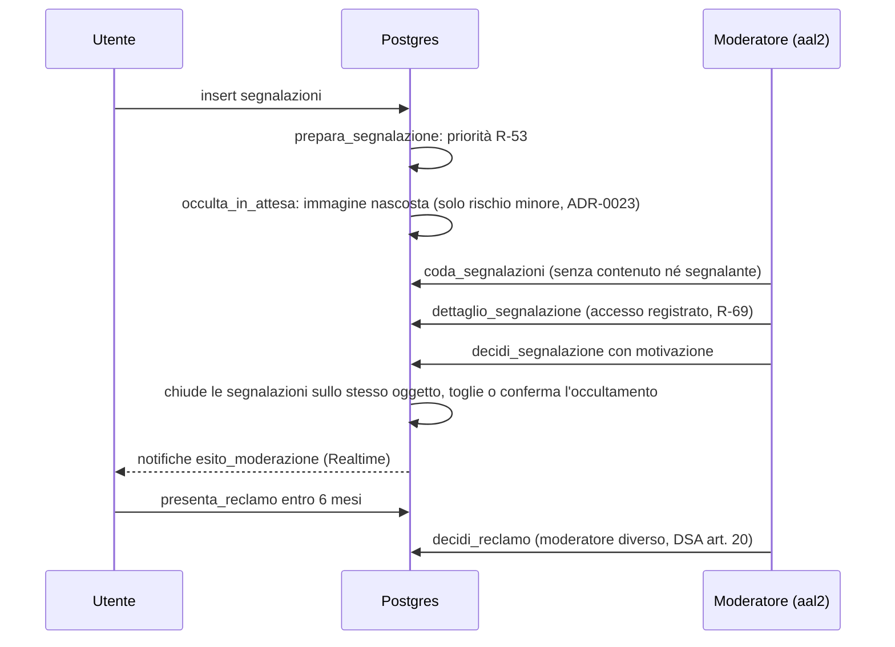
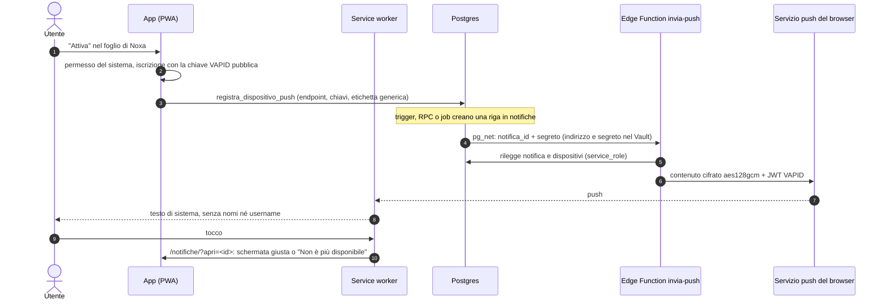
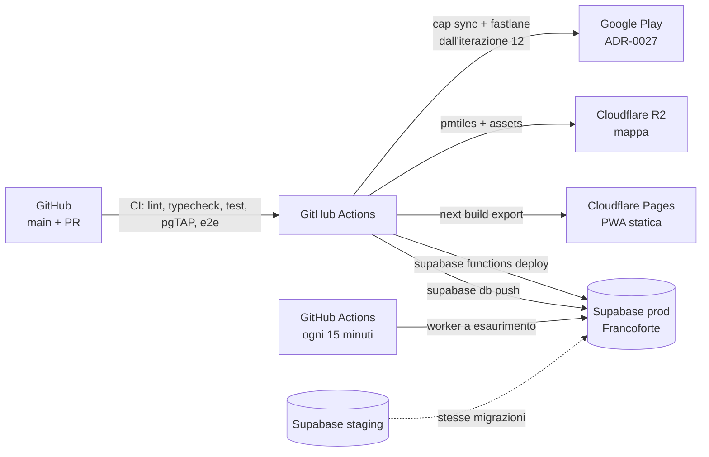

# Architettura

## 1. Panoramica

Noxa è composta da tre blocchi:

1. **App client**: un solo codice Next.js + TypeScript + Tailwind compilato come **export
   statico**, distribuito come PWA sul web e come app iOS e Android tramite Capacitor
   (ADR-0001).
2. **Backend Supabase** (regione UE, ADR-0002, ADR-0012): Postgres + PostGIS con Row Level
   Security come unico punto di autorizzazione, Auth, Storage, Realtime, Edge Functions e
   `pg_cron`. Badge e riepiloghi annuali sono calcolati da funzioni SQL nel database, così i
   dati del tracker non escono mai da Postgres.
3. **Worker** Python (FastAPI + Playwright, in Docker) per raccolta eventi, analisi dei flyer
   e deduplicazione (ADR-0003).

Non esiste un backend applicativo proprio tra app e database: l'app parla direttamente con
Supabase usando la chiave pubblica `anon` e il JWT dell'utente; ogni accesso è filtrato
dalla RLS. La logica che non può stare in una policy si trova in funzioni SQL (RPC), in
Edge Functions (per i segreti di terze parti) o nel worker (per i lavori lunghi).

## 2. Diagramma di contesto



## 3. Componenti

### 3.1 App client (`apps/web`)

| Aspetto | Scelta |
|---|---|
| Framework | Next.js (App Router) con `output: 'export'`: niente rendering lato server, Route Handlers o Server Actions (ADR-0001). |
| Routing | Route statiche; i dettagli usano parametri di query (`/evento?id=…`, `/gruppo?id=…`) perché l'export statico non genera pagine per identificativi dinamici. Il service worker ignora i parametri quando cerca una pagina nella cache. Le aree richiedono un account: senza sessione l'app porta al Benvenuto (R-07). |
| Dati | `@supabase/supabase-js` con tipi generati (`src/lib/database.types.ts`); TanStack Query per cache, retry e stato offline; validazione dei dati in ingresso e uscita con Zod. |
| Stile | Tailwind con design token generati da Claude Design (ADR-0011, [DESIGN.md](DESIGN.md)). |
| Mappe | MapLibre GL JS con la basemap Protomaps (stili `dark` e `light` personalizzati con i design token) in un file PMTiles servito, insieme a font e icone, dal bucket `mappe` in locale e da Cloudflare R2 in staging e produzione: nessuna richiesta a servizi di mappe esterni (ADR-0016, ADR-0021). |
| Nativo | Capacitor: geolocalizzazione in background (`@capacitor-community/background-geolocation`, ADR-0027), notifiche push, fotocamera, condivisione, preferenze sicure per l'area di arrivo (R-32). |
| PWA | Manifest e service worker (Workbox): cache dell'app shell e dei dati in sola lettura (PRD §5 Offline). |
| Organizzazione | `src/features/<area>/` (scopri, organizza, vivi, ricorda, account, moderazione) con componenti, hook, query e test della funzionalità; `src/components/ui` per i componenti del design system. |

### 3.2 Supabase

| Servizio | Uso |
|---|---|
| Postgres + PostGIS | Tutte le tabelle di [DATA_MODEL.md](DATA_MODEL.md) e le RPC elencate in DATA_MODEL.md §5.10 (ricerca eventi e utenti, codici invito, moderazione, metriche). |
| Auth | Email e password (almeno 10 caratteri) con verifica, CAPTCHA (Cloudflare Turnstile, ADR-0020), protezione dalle password compromesse, MFA TOTP obbligatoria per i moderatori (R-06); hook "before user created" per il controllo dell'età (§4.1); modelli delle email in italiano. |
| Storage | Bucket `avatar`, `flyer-caricati`, `flyer-pubblicati`, `immagini-locali` (foto dei locali, ADR-0018), `mappe` (DATA_MODEL.md §6). |
| Realtime | Postgres Changes per le notifiche; Broadcast privato con avvisi senza dati per gruppi, serate, Vivi e ritorno sicuro (ADR-0024, ADR-0028). |
| Edge Functions (Deno) | `invia-push` (ADR-0026: Web Push VAPID con contenuto cifrato e testi di sistema, chiamata dal webhook `private.invia_push` con `pg_net` e un segreto condiviso; FCM HTTP v1 per l'app Android con l'account di servizio nel segreto `FCM_ACCOUNT_SERVIZIO` (ADR-0027; senza il segreto i dispositivi Android si saltano) e APNs per iOS se D-13 si chiude), `elimina-account` (ADR-0025: chiama `elimina_mio_account` con il JWT dell'utente e usa `service_role` solo per cancellare i file della foto profilo). L'esportazione dei dati è la RPC `esporta_miei_dati`. |
| `pg_cron` | Job di DATA_MODEL.md §8, compresi il calcolo dei badge e dei riepiloghi annuali con funzioni SQL. |

### 3.3 Worker (`services/worker`)

| Modulo | Responsabilità |
|---|---|
| `coda` | Prelievo dei job con `select … for update skip locked`, lease (`bloccato_fino`, 10 minuti), recupero dei job con lease scaduto, retry con backoff esponenziale (massimo 5 tentativi), idempotenza per `tipo` + chiave del payload. L'esecutore (`EsecutoreCoda`) accede alla tabella tramite il protocollo `ArchivioJob`, verificabile senza database e sostituibile se la coda dovesse uscire da Postgres. Il worker non pianifica nulla: l'unico scheduler è `pg_cron` (ADR-0003). |
| `coda_postgres` | `ArchivioJob` su `coda_job`: prelievo con `for update skip locked`, un solo job in esecuzione per dominio (`chiave_concorrenza`, con indice unico), completamento, rinvio e fallimento. |
| `fonti` | `ClientHttpConforme` (`fonti/http.py`: user agent, robots.txt, intervallo per dominio, limite di pagine, cache condizionale, 5 MB per risposta; l'unico modulo che usa httpx, verificato da `test_architettura.py`); adattatori `sito_jsonld` e `instagram_business_discovery` nel registro `fonti/registro.py` (EVENT_INGESTION.md §4); strumenti `bootstrap_locali`, `prova` e `salva_fixture`. |
| `flyer` | Prompt, schema Pydantic ed estrazione con Claude API (ADR-0007). |
| `normalizzazione` | Modello Pydantic dello schema evento v1 (verificato in CI contro `packages/schemas/evento.schema.json`), date nel fuso di Milano, età minima, riferimenti all'alcol, generi, regole di validazione e impronta dei grezzi. |
| `dedup` | Normalizzazione dei titoli, confronto fuzzy con rapidfuzz, decisione e fusione (ADR-0009), golden set in `tests/dati/dedup_golden.jsonl`. |
| `raccolta` | Gestori dei job `esegui_fonte` e `deduplica_grezzo` (`pipeline.py`) dietro il protocollo `ArchivioRaccolta`, con l'implementazione Postgres in `postgres.py`; una transazione per ogni evento raccolto. |
| `api` | FastAPI con i soli endpoint interni `GET /salute` (liveness) e `GET /pronto` (readiness: database raggiungibile), usati dal healthcheck di `docker compose` in locale; il worker non è raggiungibile da internet. I comandi di amministrazione (per esempio "esegui ora una fonte") passano da RPC che inseriscono job in `coda_job`. Nel lifespan dell'applicazione avvia `CODA_CONCORRENZA` esecutori della coda (in locale). In staging e produzione il workflow `worker.yml` di GitHub Actions avvia ogni 15 minuti la stessa immagine in modalità a esaurimento: svuota la coda, al massimo per 10 minuti, e termina (ADR-0021). |
| `osservabilita` | Log JSON strutturati (structlog), Sentry, metriche per job. |

Il worker accede a Postgres con il ruolo `noxa_worker` (permessi limitati, senza
`BYPASSRLS`) e usa la chiave `service_role` **solo** nel client Storage per leggere
`flyer-caricati` e scrivere in `flyer-pubblicati` (ADR-0003).

## 4. Flussi dei dati

### 4.1 Registrazione con età



- Il codice di errore dell'hook (`NX001`…`NX006`) arriva all'app nel messaggio della risposta
  e diventa un errore di dominio (`src/lib/errori.ts`). Il trigger ripete la verifica per gli
  utenti creati con `service_role` o se l'hook non fosse configurato.
- Un'email già registrata riceve la stessa risposta di una registrazione riuscita ("Controlla la
  posta") e nessun secondo account viene creato: come il recupero della password, la
  registrazione non rivela chi ha un account.
- Lo username si verifica all'invio, non mentre si scrive: senza account non esiste un modo
  per interrogare i profili (R-07, R-10). Se è già in uso, l'app torna al passo 3 con una
  proposta.
- Le email usano modelli in italiano (`supabase/templates/`) con il link alla pagina dell'app
  che verifica il `token_hash`: la sessione nasce sul dispositivo che apre il link.
- Gli account mai confermati sono eliminati dopo 24 ore (`private.elimina_account_non_confermati`,
  DATA_MODEL.md §8), così lo username torna libero.
- Accesso, recupero e reinvio dell'email passano dallo stesso Turnstile (ADR-0020); dopo il
  recupero della password l'app chiude le sessioni sugli altri dispositivi.

### 4.2 Ricerca eventi

```mermaid
sequenceDiagram
    autonumber
    participant U as Utente
    participant A as App
    participant DB as Postgres
    participant S as Storage
    U->>A: Stasera / Domani / Weekend, filtri
    opt "Usa la mia posizione" (tocco esplicito)
        A->>A: posizione del telefono arrotondata a ~100 m, solo in memoria
    end
    A->>DB: rpc cerca_eventi(lat, lon, raggio_km, dal, al, generi, eta_minima_max, solo_amici)
    Note over DB: security invoker: la policy di eventi<br/>applica R-20, R-21 e R-23 con eta_di(auth.uid());<br/>la RLS di partecipazioni_evento lascia solo gli amici (R-67)
    DB-->>A: al massimo 300 eventi con distanza, copertina, amici e propria scelta
    A->>S: createSignedUrls (immagini-locali, flyer-pubblicati)
    Note over S: le policy dello storage seguono<br/>la visibilità di locali ed eventi
    S-->>A: link firmati per 1 ora
    Note over A,DB: lat/lon non vengono salvate né registrate (R-33);<br/>un comune scelto usa il suo centro
```

Il dettaglio (`/evento?id=`) usa la RPC `dettaglio_evento`, anch'essa `security invoker`:
un evento non visibile restituisce zero righe e l'app mostra lo stesso testo per un evento
tolto e per uno non adatto all'età. "Mi interessa" e "Partecipo" sono inserimenti, modifiche
e cancellazioni dirette su `partecipazioni_evento` (aggiornamento ottimistico, "Annulla" nel
toast); la mappa raggruppa per locale gli stessi risultati dell'elenco (MapLibre con
raggruppamento della sorgente GeoJSON e segnaposto HTML con un nome accessibile).

### 4.3 Serata di gruppo in tempo reale



### 4.4 Ritorno sicuro

Dettagli e motivi in ADR-0006, ADR-0027 e ADR-0028. Le coordinate non passano da Realtime: il
telefono le scrive con una RPC e chi guarda riceve solo un avviso senza dati, poi rilegge
l'ultima posizione con la RLS. Area di arrivo e tratta restano sul telefono (R-32).



Nell'app Android il plugin `@capacitor-community/background-geolocation` avvia un servizio in
primo piano di tipo `location` con la notifica fissa "Ritorno sicuro attivo" (R-31); basta il
permesso "Mentre usi l'app". Nella PWA `watchPosition` si ferma quando Noxa non è in primo
piano: la barra "Ritorno attivo" e il foglio di avvio lo dicono, e l'allerta parte comunque dal
server. La posizione si condivide solo dal telefono che ha avviato il ritorno.

### 4.5 Raccolta eventi e flyer

Il dettaglio è in [EVENT_INGESTION.md](EVENT_INGESTION.md).



### 4.6 Segnalazioni, decisioni e reclami



Le immagini segnalate si mostrano al moderatore con URL firmati e sfocate fino a «Mostra»;
nessuna funzione le scarica o le inoltra. L'escalation (R-55) sospende l'account, conserva
l'immagine come prova e non notifica l'account coinvolto.

## 5. Dettagli trasversali

### 5.1 Autorizzazione

- Tutta l'autorizzazione è nella RLS e nelle funzioni `private.*` (DATA_MODEL.md §4).
- Le RPC che devono vedere più dati di quelli permessi all'utente (per esempio
  `cerca_utenti`) sono `security definer` in `public`, con filtri espliciti e test dedicati.
- Le Edge Functions verificano il JWT dell'utente e usano `service_role` solo per le
  operazioni documentate (eliminazione dell'account, invio delle notifiche).

### 5.2 Gestione degli errori

- App: ogni chiamata passa da un client tipizzato che converte gli errori di Supabase in
  errori di dominio (`ErroreRete`, `ErroreAutorizzazione`, `ErroreValidazione`,
  `ErroreLimite`, `ErroreSconosciuto`), mostrati con messaggi in italiano e un'azione
  possibile. Error boundary per ogni area. Retry automatico solo per le letture idempotenti.
- Database: le eccezioni dei trigger usano codici `SQLSTATE` personalizzati (`NX001`…) mappati
  in `apps/web/src/lib/errori.ts` e documentati nella migrazione che li introduce.
- Worker: eccezioni tipizzate (`ErroreFonte`, `ErroreConformita`, `ErroreEstrazione`,
  `ErroreValidazione`); ogni job registra l'esito e un errore non recuperabile non viene
  ritentato.

### 5.3 Realtime

- Postgres Changes solo su tabelle con RLS, con filtri per l'identificativo dell'oggetto, e
  solo se la chiave primaria non rivela relazioni tra persone: la RLS non vale per gli
  eventi `DELETE`, che arrivano a ogni sessione con la chiave (oggi solo `notifiche`).
- Gruppi, serate e check-in usano avvisi senza dati su canali Broadcast privati
  (`serata:<id>`, `gruppi:<utente_id>`, `vivi:<utente_id>`) autorizzati dalla policy di `realtime.messages`; l'app ricarica con
  le RPC (DATA_MODEL.md §7).
- Il ritorno sicuro usa lo stesso schema: avvisi senza dati sul canale privato `ritorno:<id>`
  a ogni posizione (al massimo ogni 30 secondi), proroga e fine; le coordinate non viaggiano mai
  su Realtime e si rileggono con la RLS (ADR-0028).

### 5.4 Notifiche

Le notifiche sono righe in `notifiche` create da trigger e funzioni. Nell'app la campanella
delle aree si iscrive alle `INSERT` su `notifiche` dell'utente (Postgres Changes, filtrate
dalla RLS) e aggiorna il numero delle non lette; l'elenco `/notifiche/` le segna come lette.

Dall'iterazione 9 le notifiche arrivano anche sul telefono con il Web Push della PWA
(ADR-0026):



- Il testo dipende solo dal tipo e, per la moderazione, dall'esito
  (`supabase/functions/_shared/testi_push.ts`): mai nomi, username, nomi dei gruppi, locali o
  testi di altre persone sulla schermata di blocco.
- Il permesso del sistema si chiede solo dopo il tocco su "Attiva"; su iPhone il Web Push
  funziona solo con Noxa aggiunta alla schermata Home, e l'app mostra i due passi.
- I dispositivi scaduti (404, 410 dal servizio push) si tolgono all'invio; all'uscita
  dall'account l'app toglie il proprio; quelli non usati da 90 giorni li cancella
  `applica_conservazione`.
- In sviluppo il service worker di Workbox non c'è: l'app registra solo `public/sw-push.js`,
  che in produzione Workbox importa con `importScripts`.

### 5.5 Offline

Il service worker conserva l'app shell. Dall'iterazione 4 gli eventi già visti restano nella
cache in memoria di TanStack Query finché l'app è aperta, con la striscia "Sei offline" e le
azioni spente; dall'iterazione 8 TanStack Query salva in IndexedDB le query in sola lettura
(eventi già visti, serate di gruppo proprie, tracker). Le scritture del tracker sono
messe in coda e inviate al ritorno della connessione; le altre scritture richiedono la rete
e lo comunicano all'utente.

## 6. Deployment



- Ambienti: `locale` (Supabase CLI + docker-compose), `staging`, `produzione`, ognuno con un
  progetto Supabase separato.
- Le migrazioni si applicano prima a staging, poi a produzione, solo dalla CI.
- I segreti stanno nel gestore dei segreti di ciascun fornitore; `.env.example` elenca i nomi.
- Piano Supabase Free in staging e produzione finché non si apre la beta (ADR-0021).
- Backup: il workflow `backup.yml` esporta ogni notte i dati con `pg_dump`, li cifra con
  `age` e li carica su Cloudflare R2, dove restano 30 giorni; la chiave privata è fuori da
  GitHub e il ripristino usa `scripts/ripristina_backup.sh` (ADR-0025).

## 7. Scalabilità

| Area | Strategia |
|---|---|
| Letture degli eventi | Indici su `data_serata` e GiST su `locali.posizione`; RPC con limite di pagina; cache lato client. Le funzioni `private.*` sono `stable` e chiamate con `(select …)` nelle policy per sfruttare la cache dei piani. |
| Policy RLS | Funzioni sugli indici (`amicizie` con indice sulla coppia, `membri_gruppo` sulla PK); test di carico sulle query principali con 100.000 utenti sintetici prima della Fase 2. |
| Worker | Più istanze dell'esecutore in parallelo grazie a `skip locked`; la pianificazione resta in `pg_cron`, quindi aggiungere istanze non duplica i job; limite di concorrenza per dominio condiviso tramite la tabella `coda_job` (un solo job `esegui_fonte` in esecuzione per dominio). |
| Realtime | Canali per oggetto; Broadcast per le posizioni. |
| Costi del modello | Una sola chiamata per flyer; deduplicazione tramite hash dell'immagine prima della chiamata; budget giornaliero configurabile (`FLYER_BUDGET_GIORNALIERO_EUR`) oltre il quale i job restano in coda. |
| Nuove aree | `locali.provincia` e il bootstrap dei locali sono parametrizzati (F-46). |

## 8. Osservabilità

- Sentry (regione UE) per app e worker, con `beforeSend` che rimuove email, coordinate e testi
  liberi (R-62).
- Log JSON del worker con `job_id`, `tipo`, `fonte_id`, durata ed esito; mai payload
  personali o coordinate.
- Le RPC non registrano i parametri di posizione (R-33); i log di PostgREST in produzione
  sono configurati per non includere il corpo delle richieste.
- Metriche di prodotto: viste SQL aggregate (`metriche_settimanali`) lette dalla dashboard di
  amministrazione, senza strumenti di tracciamento di terze parti (ADR-0014).
- Allarmi: errori del worker oltre una soglia, fonte disattivata automaticamente, coda della
  moderazione oltre i tempi di R-53, budget dei flyer esaurito.

## 9. Sicurezza applicativa

- Content Security Policy rigorosa per la PWA e le app native: dopo la build
  `scripts/applica-csp.mjs` inserisce in ogni pagina un `<meta http-equiv>` con gli hash
  SHA-256 degli script inline (niente `'unsafe-inline'` né `'unsafe-eval'` per gli script);
  le connessioni sono ammesse solo verso l'app e Supabase, script e iframe esterni solo da
  Cloudflare Turnstile (ADR-0020). Gli attributi `style` di React richiedono
  `'unsafe-inline'` negli stili. `apps/web/public/_headers` di Cloudflare Pages aggiunge gli
  header che un meta non può esprimere (`frame-ancestors`, HSTS, `X-Content-Type-Options`,
  `Permissions-Policy`; ADR-0021). Sentry (ADR-0014) è ammesso nelle connessioni solo quando
  `NEXT_PUBLIC_SENTRY_DSN` è configurato.
- Dipendenze controllate con Dependabot e `pnpm audit` / `pip-audit` in CI.
- Le chiavi pubbliche (`anon`) sono le uniche nel client; tutto il resto sta solo nel worker e
  nelle Edge Functions.
- Penetration test esterno e DPIA prima della Fase 2 (ROADMAP.md).

## 10. Copertura delle funzionalità

Componenti e flussi coinvolti da ogni funzionalità del [PRD](PRD.md). Le tabelle sono in
[DATA_MODEL.md](DATA_MODEL.md), dove ogni tabella indica le funzionalità che la usano.

| Funzionalità | Componenti | Flusso o sezione |
|---|---|---|
| F-01 Elenco eventi con filtri | App (`features/scopri`), RPC `cerca_eventi` | §4.2 |
| F-02 Mappa | App (MapLibre + Protomaps), bucket `mappe` | §3.1, §4.2, ADR-0016 |
| F-03 Dettaglio evento | App (`/evento?id=`), RPC `dettaglio_evento`, Storage (`immagini-locali`, `flyer-pubblicati`) | §3.1, §4.2 |
| F-04 Amici che partecipano | RPC `cerca_eventi` e `dettaglio_evento` (amici visibili per la RLS) | §4.2 |
| F-05 Interessato / Partecipo | App, PostgREST su `partecipazioni_evento` | §3.2, §4.2 |
| F-06 Caricamento flyer | App (fotocamera Capacitor), Storage, worker `flyer`, Claude API | §4.5, EVENT_INGESTION.md §5 |
| F-07 Aggregatori | Worker `fonti` (nuovi adattatori) | §4.5, ADR-0008 |
| F-10 Registrazione e profilo | App, Supabase Auth (CAPTCHA), trigger di registrazione | §4.1 |
| F-11 Amicizie | App, RPC `cerca_utenti`, `crea_codice_invito`, `usa_codice_invito` | §3.2, §5.1 |
| F-12 Blocco e segnalazione | App, area di moderazione, RPC `mie_segnalazioni` e `presenta_reclamo` | §3.2, §4.6 |
| F-13 Gruppi | App, policy con `private.puo_entrare_nel_gruppo` | §5.1 |
| F-14 Serata di gruppo | App, Realtime Postgres Changes | §4.3 |
| F-15 Prevendite e liste | App (link esterni) | §4.3 |
| F-16 Trasporto | App, trigger `verifica_trasporto` | §4.3 |
| F-17 Accesso con Apple e Google | Supabase Auth (provider OAuth) | §3.2 |
| F-20 Check-in | App, RPC `fai_checkin` e `suggerimenti_checkin`, avvisi su `vivi:<utente>` | §5.3 |
| F-21 Ritorno sicuro | App nativa (servizio in primo piano), Realtime Broadcast con avvisi senza dati, `pg_cron`, `invia-push` (Web Push e FCM) | §4.4, ADR-0006, ADR-0027, ADR-0028 |
| F-22 Notifiche push | Nella Fase 1 campanella e `/notifiche/` con Realtime; dall'iterazione 9 Web Push con l'Edge Function `invia-push` (FCM con l'app Android, ADR-0027; APNs con iOS, D-13) | §5.4, ADR-0026 |
| F-30 Tracker | App (offline con coda di scritture) | §5.5 |
| F-31 Statistiche | Vista `statistiche_personali` | §3.2 |
| F-32 Badge | Funzione SQL `private.assegna_badge()` con `pg_cron` | §3.2 |
| F-33 Wrapped | Funzione SQL `private.genera_riepiloghi()` con `pg_cron`, App (immagine generata sul dispositivo) | §3.2 |
| F-40 Moderazione | App (area `/moderazione/` con navigazione propria, attivazione e codice TOTP, accesso di 8 ore; `src/features/moderazione/`), RPC di moderazione con registro delle azioni; code di flyer, segnalazioni e reclami con avviso delle urgenti | §4.5, §4.6, §5.1, SAFETY_PRIVACY.md §11, DATA_MODEL.md §5.10 |
| F-41 Diritti privacy | RPC `esporta_miei_dati`, `elimina_mio_account`; Edge Function `elimina-account` | §3.2 |
| F-42 Impostazioni di privacy | App | §3.1 |
| F-43 App installabile | Export statico, service worker, Capacitor, store | §3.1, §6, ADR-0001 |
| F-44 Raccolta eventi | Worker (`coda`, `coda_postgres`, `fonti`, `normalizzazione`, `dedup`, `raccolta`), `pg_cron` (`accoda_fonti_da_eseguire`) | §4.5, EVENT_INGESTION.md |
| F-45 Accessibilità | App, CI (axe) | DESIGN.md §4 |
| F-46 Nuove aree | Worker (bootstrap dei locali), migrazione su `locali.provincia` | §7 |

