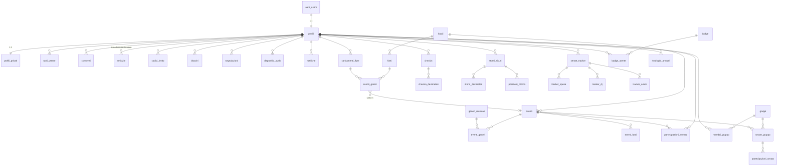

# Modello dati

Database: Postgres 15+ su Supabase con le estensioni `postgis`, `citext`, `pg_cron`,
`pg_net` e `pgtap` (solo per i test). Tutte le tabelle applicative sono nello schema
`public`, esposto dall'API di Supabase. Le funzioni di supporto alle policy sono nello schema
`private`, non esposto. Le regole citate (`R-xx`) sono definite in
[SAFETY_PRIVACY.md](SAFETY_PRIVACY.md).

## 1. Convenzioni

- Nomi di tabelle e colonne in italiano, `snake_case`, senza accenti (ADR-0010). Tabelle al
  plurale, colonne al singolare.
- Chiavi primarie `id uuid default gen_random_uuid()`, salvo le tabelle di relazione con
  chiave composta.
- Timestamp sempre `timestamptz`; colonne `creato_il`, `aggiornato_il` (trigger
  `private.imposta_aggiornato_il`).
- Importi in centesimi di euro (`integer`), mai `float`.
- Enum Postgres per gli insiemi chiusi (§3). Si aggiungono valori solo con una migrazione.
- **RLS abilitata su ogni tabella** (R-68). Una tabella senza policy per un'operazione nega
  quell'operazione. Il ruolo `anon` non ha policy (R-07).
- Ruoli Postgres:
  - `authenticated`: utenti dell'app, sempre soggetti a RLS.
  - `noxa_worker`: ruolo di login del worker, senza `BYPASSRLS`, con permessi (`GRANT`) solo
    sulle tabelle di ingestione e policy dedicate (ADR-0003). La migrazione lo crea senza
    password; in locale la password è impostata da `supabase/seed.sql`, in staging e
    produzione da un amministratore con `alter role` e conservata solo nei segreti di Fly.io.
  - `service_role`: usato solo dalle Edge Functions lato server; non arriva mai al client.

## 2. Diagramma delle relazioni

## 3. Enum

| Enum | Valori |
|---|---|
| `stato_account` | `attivo`, `sospeso` |
| `ruolo_utente` | `moderatore`, `amministratore` |
| `tipo_consenso` | `termini`, `privacy` |
| `stato_amicizia` | `in_attesa`, `accettata` |
| `canale_amicizia` | `ricerca`, `codice_invito` |
| `tipo_oggetto_segnalabile` | `profilo`, `evento`, `caricamento_flyer`, `gruppo`, `serata_gruppo` |
| `motivo_segnalazione` | `contenuto_inappropriato`, `molestie`, `adescamento_o_rischio_minore`, `spam`, `evento_falso`, `eta_errata`, `alcol_a_minori`, `altro` |
| `stato_segnalazione` | `aperta`, `in_lavorazione`, `chiusa` |
| `azione_moderazione` | `nessuna_violazione`, `rimuovi_contenuto`, `modifica_evento`, `approva_flyer`, `rifiuta_flyer`, `sospendi_account`, `riattiva_account`, `correggi_data_nascita`, `escalation_autorita`, `accesso_segnalazione` |
| `tipo_fonte` | `sito_locale`, `instagram`, `resident_advisor`, `xceed`, `dice` |
| `stato_conformita` | `da_verificare`, `consentita`, `vietata` |
| `stato_evento` | `in_revisione`, `pubblicato`, `rifiutato`, `annullato` |
| `stato_grezzo` | `nuovo`, `normalizzato`, `unito`, `in_revisione_dedup`, `scartato`, `errore` |
| `stato_caricamento` | `caricato`, `in_analisi`, `in_revisione`, `approvato`, `unito`, `rifiutato`, `errore` |
| `stato_partecipazione_evento` | `interessato`, `partecipo` |
| `ruolo_gruppo` | `admin`, `membro` |
| `stato_membro` | `invitato`, `attivo` |
| `stato_serata` | `proposta`, `confermata`, `annullata` |
| `risposta_serata` | `si`, `forse`, `no` |
| `stato_biglietto` | `nessuno`, `prevendita`, `lista`, `alla_cassa` |
| `mezzo_trasporto` | `auto_guido`, `passaggio`, `mezzi_pubblici`, `taxi_ncc`, `a_piedi`, `altro` |
| `stato_ritorno` | `attivo`, `arrivato`, `annullato`, `scaduto` |
| `categoria_spesa` | `ingresso`, `prevendita`, `trasporto`, `cibo`, `bevande_analcoliche`, `alcolici`, `guardaroba`, `altro` |
| `piattaforma` | `ios`, `android`, `web` |
| `tipo_job` | `esegui_fonte`, `analizza_flyer`, `deduplica_grezzo`, `copia_immagine_flyer`, `pulizia_flyer` |
| `stato_job` | `in_coda`, `in_esecuzione`, `completato`, `fallito` |

## 4. Funzioni di supporto alle policy (schema `private`)

Tutte sono `security definer`, `stable`, `set search_path = ''`. Ricevono identificativi
espliciti e usano `auth.uid()` solo dove indicato. Sono eseguibili dal ruolo `authenticated`
ma non sono esposte come RPC, perché lo schema `private` non è esposto.

| Funzione | Restituisce | Logica |
|---|---|---|
| `eta_di(utente uuid)` | `integer` | Anni compiuti a `(now() at time zone 'Europe/Rome')::date` da `profili_privati.data_nascita`. |
| `e_minorenne(utente uuid)` | `boolean` | `eta_di(utente) < 18`. |
| `stessa_fascia(a uuid, b uuid)` | `boolean` | `e_minorenne(a) = e_minorenne(b)`. |
| `c_e_blocco(a uuid, b uuid)` | `boolean` | Esiste una riga in `blocchi` in una delle due direzioni. |
| `sono_amici(a uuid, b uuid)` | `boolean` | Esiste una riga in `amicizie` con stato `accettata` tra `a` e `b` e `not c_e_blocco(a, b)`. |
| `puo_vedere_profilo(target uuid)` | `boolean` | `target = auth.uid()` oppure (`not c_e_blocco(auth.uid(), target)` e il profilo è `attivo` e (`sono_amici(auth.uid(), target)` oppure esiste una richiesta di amicizia `in_attesa` tra i due oppure i due sono membri dello stesso gruppo)). Non esiste visibilità per "stessa fascia": la tabella `profili` non è elencabile e la ricerca passa solo da `cerca_utenti`. Grazie all'invariante R-15, due membri dello stesso gruppo di fasce diverse sono sempre amici. Applica R-10, R-13, R-17. |
| `e_membro_attivo(gruppo uuid)` | `boolean` | `auth.uid()` è in `membri_gruppo` del gruppo con stato `attivo`. |
| `e_membro(gruppo uuid)` | `boolean` | Come sopra, con stato `invitato` oppure `attivo`. |
| `e_admin_gruppo(gruppo uuid)` | `boolean` | `auth.uid()` è membro attivo con ruolo `admin`. |
| `puo_entrare_nel_gruppo(gruppo uuid, utente uuid)` | `boolean` | Per ogni membro `m` (invitato o attivo) diverso da `utente`: `not c_e_blocco(m, utente)` e (`stessa_fascia(m, utente)` oppure `sono_amici(m, utente)`); il gruppo ha meno di 30 membri. Applica R-15. |
| `evento_visibile_a(evento uuid, utente uuid)` | `boolean` | L'evento è `pubblicato`, `eta_di(utente) >= eta_minima` e (`not riferimenti_alcol` oppure `not e_minorenne(utente)`). Applica R-20 e R-23. |
| `evento_adatto_al_gruppo(evento uuid, gruppo uuid)` | `boolean` | `evento_visibile_a(evento, m)` per ogni membro attivo `m`. Applica R-24. |
| `e_moderatore()` | `boolean` | `auth.uid()` ha ruolo `moderatore` o `amministratore` in `ruoli_utente` **e** il claim `aal` del JWT vale `aal2` (R-06). |
| `e_amministratore()` | `boolean` | Come sopra, solo con ruolo `amministratore`. |
| `e_titolare_checkin(checkin uuid)` | `boolean` | `auth.uid()` è l'autore del check-in. |
| `e_destinatario_checkin(checkin uuid)` | `boolean` | `auth.uid()` è in `checkin_destinatari` del check-in. |
| `e_titolare_ritorno(ritorno uuid)` | `boolean` | `auth.uid()` è il titolare del ritorno sicuro. |
| `e_destinatario_ritorno(ritorno uuid)` | `boolean` | `auth.uid()` è in `ritorni_destinatari` del ritorno, il ritorno è `attivo` (oppure concluso da meno di 15 minuti, per mostrare l'esito) e `sono_amici(auth.uid(), titolare)`. |

Le policy di due tabelle che si riferiscono l'una all'altra (`checkin` ↔ `checkin_destinatari`,
`ritorni_sicuri` ↔ `ritorni_destinatari`, `gruppi` ↔ `membri_gruppo`) usano **sempre** queste
funzioni `security definer` invece di sottoquery dirette: una sottoquery su una tabella con
RLS che a sua volta interroga la prima causerebbe l'errore "infinite recursion detected in
policy".

Le funzioni di tipo trigger e di manutenzione (`gestisci_nuovo_utente`,
`blocca_modifica_data_nascita`, `limita_richieste_amicizia`, `applica_blocco`,
`verifica_invariante_gruppi`, `verifica_trasporto`, `verifica_categoria_spesa`,
`limita_caricamenti_flyer`, `proteggi_eta_evento`, `verifica_checkin`, `calcola_data_serata`,
`imposta_aggiornato_il`) sono descritte insieme alle tabelle a cui si applicano; quelle
pianificate (`verifica_ritorni_scaduti`, `applica_conservazione`, `accoda_fonti_da_eseguire`,
`assegna_badge`, `genera_riepiloghi`) nel §8.

## 5. Tabelle

Notazione delle policy: **S** = `SELECT`, **I** = `INSERT`, **U** = `UPDATE`, **D** =
`DELETE`. Dove non è indicata alcuna policy, l'operazione è negata a `authenticated`.

### 5.1 Identità e account

#### `profili`
*Funzionalità: F-10, F-11, F-13.*

Dati pubblici minimi dell'utente. Non contiene informazioni sull'età (R-05).

| Colonna | Tipo | Vincoli |
|---|---|---|
| `id` | `uuid` | PK, FK → `auth.users(id)` `on delete cascade` |
| `username` | `citext` | unico, `^[a-z0-9_.]{3,20}$` |
| `nome_visualizzato` | `text` | 1–40 caratteri |
| `avatar_path` | `text` | nullable, percorso nel bucket `avatar` |
| `stato_account` | `stato_account` | default `attivo` |
| `creato_il`, `aggiornato_il` | `timestamptz` | |

- **S**: `private.puo_vedere_profilo(id)`; moderatori tramite RPC (R-69).
- **I**: nessuna. Il trigger `private.gestisci_nuovo_utente` su `auth.users` crea il profilo.
- **U**: `id = auth.uid()`. Permessi di colonna: `GRANT UPDATE (username, nome_visualizzato, avatar_path)`. `stato_account` è modificabile solo dalla RPC di moderazione.
- **D**: nessuna. L'eliminazione avviene con l'Edge Function `elimina-account` (cascata da `auth.users`).
- Test: visibilità per tutte le combinazioni di fascia, con e senza amicizia, con blocco, con account sospeso.

#### `profili_privati`
*Funzionalità: F-10, F-20, F-42.*

| Colonna | Tipo | Vincoli |
|---|---|---|
| `utente_id` | `uuid` | PK, FK → `profili(id)` `on delete cascade` |
| `data_nascita` | `date` | not null; età ≥ 14 alla creazione |
| `checkin_abilitato` | `boolean` | default `false` (R-30) |
| `partecipazioni_visibili` | `boolean` | default `true` (R-67) |
| `notifiche_push_abilitate` | `boolean` | default `false` |
| `creato_il`, `aggiornato_il` | `timestamptz` | |

- **S**: `utente_id = auth.uid()`.
- **U**: `utente_id = auth.uid()`; `GRANT UPDATE (checkin_abilitato, partecipazioni_visibili, notifiche_push_abilitate)`. Il trigger `private.blocca_modifica_data_nascita` rifiuta qualsiasi modifica di `data_nascita` che non arrivi dalla RPC `public.correggi_data_nascita` (riservata agli amministratori e registrata in `azioni_moderazione`) (R-02).
- **I/D**: nessuna (creazione da trigger, eliminazione a cascata).
- Trigger `private.gestisci_nuovo_utente` (`after insert on auth.users`): legge `username`, `nome_visualizzato` e `data_nascita` da `raw_user_meta_data`, verifica età ≥ 14 (R-01) e sintassi, crea `profili` e `profili_privati`, poi rimuove `data_nascita` dai metadati. Se una verifica fallisce lancia un'eccezione e la registrazione viene annullata.

#### `ruoli_utente`
*Funzionalità: F-40.*

| Colonna | Tipo | Vincoli |
|---|---|---|
| `utente_id` | `uuid` | FK → `profili(id)` `on delete cascade` |
| `ruolo` | `ruolo_utente` | PK (`utente_id`, `ruolo`) |
| `assegnato_il` | `timestamptz` | |

- **S**: `utente_id = auth.uid()` (l'app mostra il menu di moderazione).
- **I/U/D**: nessuna. Gestiti solo con `service_role` dalla console di amministrazione.

#### `consensi`
*Funzionalità: F-10, F-41.*

| Colonna | Tipo | Vincoli |
|---|---|---|
| `id` | `uuid` | PK |
| `utente_id` | `uuid` | FK → `profili(id)` `on delete cascade` |
| `tipo` | `tipo_consenso` | |
| `versione` | `text` | es. `2026-10` |
| `accettato_il` | `timestamptz` | default `now()` |

- **S**: `utente_id = auth.uid()`.
- **I**: `utente_id = auth.uid()`.
- **U/D**: nessuna (registro di sola aggiunta, R-63).

#### `dispositivi_push`
*Funzionalità: F-22.*

| Colonna | Tipo | Vincoli |
|---|---|---|
| `id` | `uuid` | PK |
| `utente_id` | `uuid` | FK → `profili(id)` `on delete cascade` |
| `piattaforma` | `piattaforma` | |
| `token` | `text` | unico |
| `creato_il`, `ultimo_uso_il` | `timestamptz` | |

- **S/I/U/D**: `utente_id = auth.uid()`.

#### `notifiche`
*Funzionalità: F-11, F-13, F-14, F-21, F-22, F-32, F-33, F-40.*

| Colonna | Tipo | Vincoli |
|---|---|---|
| `id` | `uuid` | PK |
| `utente_id` | `uuid` | FK → `profili(id)` `on delete cascade` |
| `tipo` | `text` | check su un elenco: `richiesta_amicizia`, `amicizia_accettata`, `invito_gruppo`, `nuova_serata`, `aggiornamento_serata`, `checkin_amico`, `ritorno_avviato`, `ritorno_allerta`, `ritorno_arrivato`, `esito_moderazione`, `rimozione_gruppo`, `badge_ottenuto`, `riepilogo_pronto` |
| `dati` | `jsonb` | identificativi degli oggetti collegati, senza testi liberi di altri utenti |
| `letta_il` | `timestamptz` | nullable |
| `inviata_push_il` | `timestamptz` | nullable |
| `creata_il` | `timestamptz` | |

- **S**: `utente_id = auth.uid()`.
- **U**: `utente_id = auth.uid()`; `GRANT UPDATE (letta_il)`.
- **I**: nessuna per `authenticated`; le righe sono create da funzioni `security definer` e dai trigger. Un webhook del database sull'`INSERT` chiama l'Edge Function `invia-push`.
- Conservazione: 90 giorni.

### 5.2 Relazioni tra utenti

#### `amicizie`
*Funzionalità: F-04, F-11.*

| Colonna | Tipo | Vincoli |
|---|---|---|
| `id` | `uuid` | PK |
| `richiedente_id` | `uuid` | FK → `profili(id)` `on delete cascade` |
| `destinatario_id` | `uuid` | FK → `profili(id)` `on delete cascade`; diverso da `richiedente_id` |
| `stato` | `stato_amicizia` | default `in_attesa` |
| `canale` | `canale_amicizia` | |
| `creata_il`, `accettata_il` | `timestamptz` | |

Indice unico su `(least(richiedente_id, destinatario_id), greatest(richiedente_id, destinatario_id))`.

- **S**: `auth.uid() in (richiedente_id, destinatario_id)`.
- **I**: `richiedente_id = auth.uid()` e `canale = 'ricerca'` e `stato = 'in_attesa'` e `private.stessa_fascia(richiedente_id, destinatario_id)` e `not private.c_e_blocco(...)` (R-10, R-11). Il canale `codice_invito` si usa solo con la RPC `usa_codice_invito` (R-12).
- **U**: `destinatario_id = auth.uid()` e `stato = 'in_attesa'` (using), nuovo stato `accettata` (with check) (R-11).
- **D**: `auth.uid() in (richiedente_id, destinatario_id)` (rifiuto, annullamento, rimozione).
- Trigger: `private.limita_richieste_amicizia` (R-14); `after delete` controlla l'invariante dei gruppi (R-15); crea le notifiche `richiesta_amicizia` e `amicizia_accettata`.

#### `codici_invito`
*Funzionalità: F-11.*

| Colonna | Tipo | Vincoli |
|---|---|---|
| `codice` | `text` | PK, 10 caratteri casuali senza caratteri ambigui |
| `creato_da` | `uuid` | FK → `profili(id)` `on delete cascade` |
| `creato_il` | `timestamptz` | |
| `scade_il` | `timestamptz` | `creato_il + interval '15 minutes'` |
| `usato_da` | `uuid` | nullable |
| `usato_il` | `timestamptz` | nullable |

- **S**: `creato_da = auth.uid()`.
- **I/U/D**: nessuna. RPC `public.crea_codice_invito()` (al massimo 10 ogni 24 ore) e `public.usa_codice_invito(codice)`. La seconda verifica: codice valido, non usato, non scaduto, nessun blocco, nessuna amicizia esistente; poi crea un'amicizia `in_attesa` con canale `codice_invito`, con il **titolare del codice come destinatario**, che quindi deve accettarla (R-12).

#### `blocchi`
*Funzionalità: F-12, F-42.*

| Colonna | Tipo | Vincoli |
|---|---|---|
| `bloccante_id` | `uuid` | FK → `profili(id)` `on delete cascade` |
| `bloccato_id` | `uuid` | FK → `profili(id)` `on delete cascade` |
| `creato_il` | `timestamptz` | PK (`bloccante_id`, `bloccato_id`) |

- **S/I/D**: `bloccante_id = auth.uid()`. Il bloccato non vede il blocco (R-17).
- Trigger `private.applica_blocco` (`after insert`): elimina l'amicizia, le richieste e gli inviti a gruppi in attesa tra i due e applica R-15.

#### `segnalazioni`
*Funzionalità: F-12, F-40.*

| Colonna | Tipo | Vincoli |
|---|---|---|
| `id` | `uuid` | PK |
| `segnalante_id` | `uuid` | FK → `profili(id)` `on delete set null` |
| `tipo_oggetto` | `tipo_oggetto_segnalabile` | |
| `oggetto_id` | `uuid` | |
| `motivo` | `motivo_segnalazione` | |
| `dettagli` | `text` | al massimo 1000 caratteri |
| `priorita` | `smallint` | calcolata da trigger secondo R-53 (1 = massima) |
| `stato` | `stato_segnalazione` | default `aperta` |
| `gestita_da` | `uuid` | nullable |
| `conservazione_legale` | `boolean` | default `false` |
| `creata_il`, `chiusa_il` | `timestamptz` | |

- **S**: `segnalante_id = auth.uid()` (stato della propria segnalazione) oppure `private.e_moderatore()`.
- **I**: `segnalante_id = auth.uid()`.
- **U**: `private.e_moderatore()`.
- **D**: nessuna.

#### `azioni_moderazione`
*Funzionalità: F-40.*

Registro di sola aggiunta delle decisioni e degli accessi (DSA art. 17, R-53, R-69).

| Colonna | Tipo | Vincoli |
|---|---|---|
| `id` | `uuid` | PK |
| `moderatore_id` | `uuid` | FK → `profili(id)` `on delete set null` |
| `segnalazione_id` | `uuid` | nullable, FK → `segnalazioni(id)` |
| `tipo_oggetto` | `tipo_oggetto_segnalabile` | |
| `oggetto_id` | `uuid` | |
| `azione` | `azione_moderazione` | |
| `motivazione` | `text` | obbligatoria tranne che per `accesso_segnalazione` |
| `conservazione_legale` | `boolean` | default `false` |
| `creata_il` | `timestamptz` | |

- **S**: `private.e_moderatore()`.
- **I**: `private.e_moderatore()` e `moderatore_id = auth.uid()`.
- **U/D**: nessuna.

### 5.3 Locali, fonti, eventi

#### `locali`
*Funzionalità: F-01, F-02, F-03, F-44, F-46.*

| Colonna | Tipo | Vincoli |
|---|---|---|
| `id` | `uuid` | PK |
| `nome` | `text` | |
| `nome_normalizzato` | `text` | per il matching (EVENT_INGESTION.md §6.1) |
| `indirizzo`, `comune` | `text` | |
| `provincia` | `text` | check `in ('MI', 'MB')` nella Fase 1; l'elenco si estende con una migrazione (Fase 3) |
| `posizione` | `geography(Point, 4326)` | indice GiST |
| `osm_id` | `text` | nullable, unico |
| `google_place_id` | `text` | nullable, unico (unico dato di Google conservato, ADR-0008) |
| `sito_web`, `instagram_username` | `text` | nullable |
| `attivo` | `boolean` | default `true` |
| `creato_il`, `aggiornato_il` | `timestamptz` | |

- **S**: `authenticated` con `attivo = true`; moderatori: tutti.
- **I/U**: `private.e_moderatore()`.
- Worker: `GRANT SELECT` a `noxa_worker`, policy `to noxa_worker using (true)`.

#### `fonti`
*Funzionalità: F-07, F-40, F-44.*

Una fonte è un punto da cui si raccolgono eventi: il sito di un locale, il suo account
Instagram, la sua pagina su un aggregatore.

| Colonna | Tipo | Vincoli |
|---|---|---|
| `id` | `uuid` | PK |
| `locale_id` | `uuid` | FK → `locali(id)` |
| `tipo` | `tipo_fonte` | |
| `url` | `text` | URL della pagina o username Instagram |
| `adattatore` | `text` | nome registrato nel worker (es. `sito_jsonld`, `instagram_business_discovery`) |
| `frequenza_minuti` | `integer` | ≥ 360 per i siti, ≥ 720 per Instagram |
| `stato_conformita` | `stato_conformita` | default `da_verificare` |
| `note_conformita` | `text` | esito della verifica di robots.txt e termini d'uso |
| `verificata_il`, `verificata_da` | | |
| `attiva` | `boolean` | check: `attiva` implica `stato_conformita = 'consentita'` (ADR-0008) |
| `ultima_esecuzione_il` | `timestamptz` | |
| `ultimo_esito` | `jsonb` | conteggi e codice di errore |
| `errori_consecutivi` | `integer` | dopo 5 la fonte viene disattivata automaticamente |

- **S/I/U**: `private.e_moderatore()`.
- Worker: `SELECT` e `UPDATE (ultima_esecuzione_il, ultimo_esito, errori_consecutivi, attiva)`. Il worker può solo **disattivare** (`with check (attiva = false or attiva = old.attiva)`, applicato con un trigger).

#### `eventi`
*Funzionalità: F-01, F-02, F-03, F-06, F-44.*

| Colonna | Tipo | Vincoli |
|---|---|---|
| `id` | `uuid` | PK |
| `locale_id` | `uuid` | FK → `locali(id)`, not null |
| `titolo` | `text` | 1–200 caratteri |
| `descrizione` | `text` | al massimo 500 caratteri, nullable |
| `inizio` | `timestamptz` | |
| `fine` | `timestamptz` | nullable, > `inizio` |
| `data_serata` | `date` | calcolata dal trigger `private.calcola_data_serata`: data di `inizio - 6 ore` nel fuso `Europe/Rome` |
| `eta_minima` | `smallint` | not null, default 18, check 14–30 (R-20, R-21) |
| `eta_minima_dichiarata` | `boolean` | `false` se il valore è quello predefinito |
| `riferimenti_alcol` | `boolean` | default `false` (R-23) |
| `artisti` | `text[]` | al massimo 20 elementi |
| `prezzo_min_centesimi` | `integer` | nullable, ≥ 0 |
| `url_biglietti` | `text` | nullable, link esterno (PRD F-15) |
| `immagine_path` | `text` | nullable, solo da flyer approvato, bucket `flyer-pubblicati` |
| `stato` | `stato_evento` | |
| `ultima_verifica_il` | `timestamptz` | ultima volta in cui una fonte ha confermato l'evento |
| `creato_il`, `aggiornato_il` | `timestamptz` | |

Indici: `(data_serata)`, `(locale_id, data_serata)`, GIN su `artisti`, indice trigram su
`titolo` per la deduplicazione.

- **S** (`authenticated`): `private.evento_visibile_a(id, auth.uid())` (R-20, R-21, R-23). Moderatori: tutti.
- **U**: `private.e_moderatore()` (approvazione, correzione, annullamento).
- **I/D**: nessuna per `authenticated`.
- Worker: `SELECT`, `INSERT`, `UPDATE` con policy `to noxa_worker`. Il trigger `private.proteggi_eta_evento` impedisce al worker di abbassare `eta_minima` quando `eta_minima_dichiarata = true` e di impostare `riferimenti_alcol` da `true` a `false` (R-22); solo un moderatore può farlo, con una riga in `azioni_moderazione`. Se invece l'età era quella predefinita (`eta_minima_dichiarata = false`), la prima età dichiarata da una fonte verificata la sostituisce, anche se più bassa di 18: diventa un dato noto e non più una supposizione (R-21).
- RPC `public.cerca_eventi(lat double precision, lon double precision, raggio_km numeric, dal date, al date, generi text[], eta_minima_max smallint, solo_amici boolean)`: `security invoker`, quindi soggetta alla policy. Restituisce gli eventi con la distanza (`ST_Distance` su `geography`) e il numero di amici partecipanti visibili. Le coordinate non vengono salvate (R-33).

#### `generi_musicali`
*Funzionalità: F-01.*

| Colonna | Tipo | Vincoli |
|---|---|---|
| `codice` | `text` | PK (es. `techno`, `house`, `reggaeton`, `hip_hop`, `commerciale`, `latino`, `drum_and_bass`, `elettronica`, `live`, `altro`) |
| `nome` | `text` | |

- **S**: `authenticated`. **I/U/D**: solo migrazioni.

#### `eventi_generi`
*Funzionalità: F-01, F-03.*

| Colonna | Tipo | Vincoli |
|---|---|---|
| `evento_id` | `uuid` | FK → `eventi(id)` `on delete cascade` |
| `genere_codice` | `text` | FK → `generi_musicali(codice)`; PK composta |

- **S**: `exists (select 1 from eventi e where e.id = evento_id)`. La sottoquery è soggetta alla RLS di `eventi`.
- Worker: `SELECT`, `INSERT`, `DELETE`.

#### `eventi_fonti`
*Funzionalità: F-03, F-06, F-44.*

Provenienza di ogni evento: tutte le fonti che lo hanno confermato.

| Colonna | Tipo | Vincoli |
|---|---|---|
| `id` | `uuid` | PK |
| `evento_id` | `uuid` | FK → `eventi(id)` `on delete cascade` |
| `fonte_id` | `uuid` | nullable, FK → `fonti(id)` |
| `caricamento_flyer_id` | `uuid` | nullable, FK → `caricamenti_flyer(id)` `on delete set null` |
| `tipo_origine` | `text` | `tipo_fonte` oppure `flyer` |
| `url_originale` | `text` | nullable per i flyer |
| `id_esterno` | `text` | nullable |
| `raccolto_il` | `timestamptz` | |

Vincolo: esattamente uno tra `fonte_id` e `caricamento_flyer_id` è valorizzato, oppure
nessuno dei due se il caricamento è stato eliminato.

- **S**: come `eventi_generi`. `GRANT SELECT` escludendo `caricamento_flyer_id`, così chi ha caricato un flyer resta anonimo.
- Worker: `SELECT`, `INSERT`.

#### `eventi_grezzi`
*Funzionalità: F-06, F-07, F-40, F-44.*

Area di transito della pipeline (EVENT_INGESTION.md §3).

| Colonna | Tipo | Vincoli |
|---|---|---|
| `id` | `uuid` | PK |
| `fonte_id` | `uuid` | nullable, FK → `fonti(id)` |
| `caricamento_flyer_id` | `uuid` | nullable, FK → `caricamenti_flyer(id)` `on delete cascade` |
| `payload` | `jsonb` | conforme a `packages/schemas/evento.schema.json` |
| `hash_contenuto` | `text` | SHA-256 del payload normalizzato; unico per `fonte_id` |
| `stato` | `stato_grezzo` | |
| `evento_id` | `uuid` | nullable: evento creato o in cui il grezzo è stato unito |
| `evento_candidato_id` | `uuid` | nullable: possibile duplicato da revisionare |
| `punteggio_dedup` | `numeric(5,2)` | nullable |
| `nota_revisione` | `text` | nullable: motivo della revisione (es. "locale non riconosciuto", "modifica rilevante") |
| `errore` | `text` | nullable |
| `creato_il` | `timestamptz` | |

- **S/U**: `private.e_moderatore()` (revisione dei duplicati).
- Worker: `SELECT`, `INSERT`, `UPDATE`.
- Conservazione: 30 giorni.

#### `caricamenti_flyer`
*Funzionalità: F-06, F-40.*

| Colonna | Tipo | Vincoli |
|---|---|---|
| `id` | `uuid` | PK |
| `utente_id` | `uuid` | FK → `profili(id)` `on delete set null` |
| `storage_path` | `text` | `<utente_id>/<uuid>.<ext>` nel bucket `flyer-caricati` |
| `stato` | `stato_caricamento` | default `caricato` |
| `risultato_estrazione` | `jsonb` | output validato del modello |
| `modello` | `text` | id del modello usato |
| `versione_prompt` | `text` | |
| `confidenza` | `numeric(3,2)` | 0–1 |
| `phash` | `text` | hash percettivo dell'immagine (EVENT_INGESTION.md §3.2) |
| `evento_id` | `uuid` | nullable; resta null finché il locale non è risolto (EVENT_INGESTION.md §3.1, passo 5) |
| `motivo_rifiuto` | `text` | nullable, mostrato all'utente |
| `creato_il`, `aggiornato_il` | `timestamptz` | |

- **S**: `utente_id = auth.uid()` oppure `private.e_moderatore()`, con `GRANT SELECT (id, stato, evento_id, motivo_rifiuto, creato_il)` al ruolo `authenticated`: l'utente vede lo stato, non l'output grezzo del modello. I permessi di colonna valgono per tutto il ruolo `authenticated`, moderatori compresi: i moderatori leggono le altre colonne (`risultato_estrazione`, `confidenza`, `storage_path`) solo tramite la RPC `public.coda_flyer()`, che non restituisce `utente_id` (R-69).
- **I**: `utente_id = auth.uid()` e `stato = 'caricato'` e `storage_path like auth.uid()::text || '/%'`. Trigger `private.limita_caricamenti_flyer` (R-54) e accodamento del job `analizza_flyer`.
- **U**: nessuna diretta; le decisioni passano dalla RPC `public.decidi_flyer(caricamento uuid, esito text, correzioni jsonb, motivazione text)`, che aggiorna caricamento ed evento e registra l'azione.
- **D**: `utente_id = auth.uid()`: elimina la richiesta e l'immagine, ma non l'evento già approvato.
- Worker: `SELECT`, `UPDATE (stato, risultato_estrazione, modello, versione_prompt, confidenza, phash, evento_id, motivo_rifiuto)`.

### 5.4 Partecipazione e gruppi

#### `partecipazioni_evento`
*Funzionalità: F-04, F-05.*

| Colonna | Tipo | Vincoli |
|---|---|---|
| `utente_id` | `uuid` | FK → `profili(id)` `on delete cascade` |
| `evento_id` | `uuid` | FK → `eventi(id)` `on delete cascade`; PK composta |
| `stato` | `stato_partecipazione_evento` | |
| `visibile_agli_amici` | `boolean` | default da `profili_privati.partecipazioni_visibili` |
| `creato_il`, `aggiornato_il` | `timestamptz` | |

- **S**: `utente_id = auth.uid()` oppure (`visibile_agli_amici` e `private.sono_amici(auth.uid(), utente_id)` e `private.evento_visibile_a(evento_id, auth.uid())`) (R-67).
- **I/U**: `utente_id = auth.uid()` e `private.evento_visibile_a(evento_id, auth.uid())`.
- **D**: `utente_id = auth.uid()`.

#### `gruppi`
*Funzionalità: F-13.*

| Colonna | Tipo | Vincoli |
|---|---|---|
| `id` | `uuid` | PK |
| `nome` | `text` | 1–40 caratteri |
| `creato_da` | `uuid` | FK → `profili(id)` `on delete set null` |
| `creato_il`, `aggiornato_il` | `timestamptz` | |

- **S**: `private.e_membro(id)`.
- **I**: `creato_da = auth.uid()`. Un trigger inserisce il creatore come `admin` attivo.
- **U/D**: `private.e_admin_gruppo(id)`.

#### `membri_gruppo`
*Funzionalità: F-13.*

| Colonna | Tipo | Vincoli |
|---|---|---|
| `gruppo_id` | `uuid` | FK → `gruppi(id)` `on delete cascade` |
| `utente_id` | `uuid` | FK → `profili(id)` `on delete cascade`; PK composta |
| `ruolo` | `ruolo_gruppo` | default `membro` |
| `stato` | `stato_membro` | default `invitato` |
| `invitato_da` | `uuid` | nullable |
| `creato_il`, `aggiornato_il` | `timestamptz` | |

- **S**: `private.e_membro(gruppo_id)`.
- **I**: `private.e_membro_attivo(gruppo_id)` e `invitato_da = auth.uid()` e `stato = 'invitato'` e `ruolo = 'membro'` e `private.sono_amici(auth.uid(), utente_id)` e `private.puo_entrare_nel_gruppo(gruppo_id, utente_id)` (R-15).
- **U**: l'invitato porta il proprio `stato` da `invitato` ad `attivo`; un admin modifica `ruolo`. Due policy distinte, con `GRANT UPDATE (stato, ruolo)`.
- **D**: `utente_id = auth.uid()` (uscita) oppure `private.e_admin_gruppo(gruppo_id)`.
- Il job giornaliero `private.verifica_invariante_gruppi()` applica R-15 dopo i compleanni.

#### `serate_gruppo`
*Funzionalità: F-14, F-15.*

| Colonna | Tipo | Vincoli |
|---|---|---|
| `id` | `uuid` | PK |
| `gruppo_id` | `uuid` | FK → `gruppi(id)` `on delete cascade` |
| `evento_id` | `uuid` | nullable, FK → `eventi(id)` |
| `titolo` | `text` | 1–80 caratteri; obbligatorio solo se `evento_id` è null |
| `data_serata` | `date` | |
| `ora_ritrovo` | `time` | nullable |
| `luogo_ritrovo` | `text` | al massimo 120 caratteri |
| `url_prevendita`, `url_lista` | `text` | nullable, solo `https://` |
| `note` | `text` | al massimo 500 caratteri (R-16) |
| `stato` | `stato_serata` | default `proposta` |
| `creata_da` | `uuid` | FK → `profili(id)` `on delete set null` |
| `creata_il`, `aggiornata_il` | `timestamptz` | |

- **S**: `private.e_membro(gruppo_id)` e (`evento_id is null` oppure `private.evento_visibile_a(evento_id, auth.uid())`) (R-24).
- **I**: `private.e_membro_attivo(gruppo_id)` e `creata_da = auth.uid()` e (`evento_id is null` oppure `private.evento_adatto_al_gruppo(evento_id, gruppo_id)`).
- **U**: (`creata_da = auth.uid()` oppure `private.e_admin_gruppo(gruppo_id)`) con lo stesso controllo sull'evento.
- **D**: come **U**.

#### `partecipazioni_serata`
*Funzionalità: F-14, F-15, F-16.*

| Colonna | Tipo | Vincoli |
|---|---|---|
| `serata_id` | `uuid` | FK → `serate_gruppo(id)` `on delete cascade` |
| `utente_id` | `uuid` | FK → `profili(id)` `on delete cascade`; PK composta |
| `risposta` | `risposta_serata` | |
| `biglietto` | `stato_biglietto` | default `nessuno` |
| `trasporto_andata` | `mezzo_trasporto` | nullable |
| `trasporto_ritorno` | `mezzo_trasporto` | nullable |
| `posti_liberi` | `smallint` | 0–8, solo con `auto_guido` |
| `passaggio_da` | `uuid` | nullable: membro con `auto_guido` |
| `aggiornato_il` | `timestamptz` | |

- **S**: `exists (select 1 from serate_gruppo s where s.id = serata_id)` (eredita R-24).
- **I/U**: `utente_id = auth.uid()` e membro attivo del gruppo della serata. Il trigger `private.verifica_trasporto` controlla che `auto_guido` sia scelto solo da maggiorenni (età legale per la patente B) e che `passaggio_da` indichi un membro della stessa serata con `auto_guido`.
- **D**: `utente_id = auth.uid()`.
- Realtime: pubblicata con Postgres Changes per aggiornare la serata dal vivo (ARCHITECTURE.md §5.3).

### 5.5 Vivi: check-in e ritorno sicuro

#### `checkin`
*Funzionalità: F-20.*

| Colonna | Tipo | Vincoli |
|---|---|---|
| `id` | `uuid` | PK |
| `utente_id` | `uuid` | FK → `profili(id)` `on delete cascade` |
| `locale_id` | `uuid` | FK → `locali(id)` (nessuna coordinata, R-30) |
| `evento_id` | `uuid` | nullable |
| `creato_il` | `timestamptz` | |
| `scade_il` | `timestamptz` | `creato_il + interval '6 hours'` |
| `terminato_il` | `timestamptz` | nullable |

- **S**: `utente_id = auth.uid()` oppure (`scade_il > now()` e `terminato_il is null` e `private.e_destinatario_checkin(id)` e `private.sono_amici(auth.uid(), utente_id)`).
- **I**: `utente_id = auth.uid()` e (`evento_id is null` oppure `private.evento_visibile_a(evento_id, auth.uid())`); il trigger `private.verifica_checkin` controlla `profili_privati.checkin_abilitato = true` (R-30) e crea le notifiche `checkin_amico` per i destinatari.
- **U**: `utente_id = auth.uid()`; `GRANT UPDATE (terminato_il)`.
- **D**: `utente_id = auth.uid()`.

#### `checkin_destinatari`
*Funzionalità: F-20.*

| Colonna | Tipo | Vincoli |
|---|---|---|
| `checkin_id` | `uuid` | FK → `checkin(id)` `on delete cascade` |
| `amico_id` | `uuid` | FK → `profili(id)` `on delete cascade`; PK composta |

- **S**: `private.e_titolare_checkin(checkin_id)` oppure `amico_id = auth.uid()`.
- **I**: `private.e_titolare_checkin(checkin_id)` e `private.sono_amici(auth.uid(), amico_id)`.
- **D**: `private.e_titolare_checkin(checkin_id)`.

#### `ritorni_sicuri`
*Funzionalità: F-21.*

| Colonna | Tipo | Vincoli |
|---|---|---|
| `id` | `uuid` | PK |
| `utente_id` | `uuid` | FK → `profili(id)` `on delete cascade` |
| `stato` | `stato_ritorno` | default `attivo` |
| `avviato_il` | `timestamptz` | |
| `arrivo_previsto` | `timestamptz` | tra 10 minuti e 4 ore dopo `avviato_il`; prorogabile |
| `allerta_inviata_il` | `timestamptz` | nullable |
| `concluso_il` | `timestamptz` | nullable |
| `ultima_posizione_il` | `timestamptz` | nullable |

Indice unico parziale: al massimo un ritorno `attivo` per utente.

- **S**: `utente_id = auth.uid()` oppure `private.e_destinatario_ritorno(id)`.
- **I**: `utente_id = auth.uid()` e `stato = 'attivo'`.
- **U**: `utente_id = auth.uid()`; `GRANT UPDATE (stato, arrivo_previsto, concluso_il)`; transizioni consentite: `attivo → arrivato | annullato`, proroga di `arrivo_previsto` solo se `attivo`.
- **D**: nessuna (pulizia con il job di conservazione).
- `private.verifica_ritorni_scaduti()` (ogni minuto, `pg_cron`): se `now() > arrivo_previsto` e `allerta_inviata_il is null`, imposta `allerta_inviata_il` e crea notifiche `ritorno_allerta` per i destinatari con l'ultima posizione nota; se `now() > arrivo_previsto + 2 ore`, imposta `stato = 'scaduto'` (R-31).

#### `ritorni_destinatari`
*Funzionalità: F-21.*

| Colonna | Tipo | Vincoli |
|---|---|---|
| `ritorno_id` | `uuid` | FK → `ritorni_sicuri(id)` `on delete cascade` |
| `amico_id` | `uuid` | FK → `profili(id)` `on delete cascade`; PK composta |

- **S**: `private.e_titolare_ritorno(ritorno_id)` oppure `amico_id = auth.uid()`.
- **I**: `private.e_titolare_ritorno(ritorno_id)`, ritorno `attivo`, `private.sono_amici(auth.uid(), amico_id)`, al massimo 5 righe per ritorno (trigger) (R-31).
- **D**: `private.e_titolare_ritorno(ritorno_id)`.

#### `posizioni_ritorno`
*Funzionalità: F-21.*

| Colonna | Tipo | Vincoli |
|---|---|---|
| `id` | `bigint` | PK, identity |
| `ritorno_id` | `uuid` | FK → `ritorni_sicuri(id)` `on delete cascade` |
| `posizione` | `geography(Point, 4326)` | |
| `precisione_m` | `real` | |
| `registrata_il` | `timestamptz` | |

- **S**: `private.e_titolare_ritorno(ritorno_id)` oppure `private.e_destinatario_ritorno(ritorno_id)`.
- **I**: `private.e_titolare_ritorno(ritorno_id)`, ritorno `attivo`; al massimo una posizione ogni 30 secondi (trigger).
- **U/D**: nessuna.
- Le posizioni in tempo reale viaggiano anche su un canale Realtime Broadcast privato `ritorno:<id>`, autorizzato con policy su `realtime.messages` (ARCHITECTURE.md §5.4); la tabella conserva le posizioni per l'allerta e per chi apre l'app in un secondo momento.
- Conservazione: 24 ore dalla fine (R-31).

### 5.6 Ricorda: tracker, badge, riepilogo

#### `serate_tracker`
*Funzionalità: F-30, F-31.*

| Colonna | Tipo | Vincoli |
|---|---|---|
| `id` | `uuid` | PK |
| `utente_id` | `uuid` | FK → `profili(id)` `on delete cascade` |
| `data_serata` | `date` | |
| `evento_id` | `uuid` | nullable, FK → `eventi(id)` `on delete set null` |
| `locale_id` | `uuid` | nullable, FK → `locali(id)` |
| `nome_locale_libero` | `text` | nullable, per locali non presenti in catalogo; al massimo 80 caratteri |
| `voto` | `smallint` | nullable, 1–5 |
| `note` | `text` | al massimo 1000 caratteri, private |
| `creato_il`, `aggiornato_il` | `timestamptz` | |

- **S/U/D**: `utente_id = auth.uid()`.
- **I**: `utente_id = auth.uid()` e (`evento_id is null` oppure `private.evento_visibile_a(evento_id, auth.uid())`).
- Il tracker è privato: nessun altro utente lo vede.

#### `tracker_spese`
*Funzionalità: F-30, F-31.*

| Colonna | Tipo | Vincoli |
|---|---|---|
| `id` | `uuid` | PK |
| `serata_tracker_id` | `uuid` | FK → `serate_tracker(id)` `on delete cascade` |
| `categoria` | `categoria_spesa` | trigger `private.verifica_categoria_spesa`: `alcolici` rifiutata se il titolare è minorenne (R-40) |
| `importo_centesimi` | `integer` | 0–100000 |

- **S/I/U/D**: titolare della serata (`exists` su `serate_tracker` con `utente_id = auth.uid()`).

#### `tracker_dj`
*Funzionalità: F-30, F-31.*

| Colonna | Tipo | Vincoli |
|---|---|---|
| `serata_tracker_id` | `uuid` | FK `on delete cascade` |
| `nome_dj` | `text` | 1–80 caratteri; PK composta |

- **S/I/D**: titolare della serata.

#### `tracker_amici`
*Funzionalità: F-30.*

| Colonna | Tipo | Vincoli |
|---|---|---|
| `serata_tracker_id` | `uuid` | FK `on delete cascade` |
| `amico_id` | `uuid` | FK → `profili(id)` `on delete cascade`; PK composta |

- **S/D**: titolare della serata.
- **I**: titolare della serata e `private.sono_amici(auth.uid(), amico_id)`.
- L'amico indicato non riceve notifiche e non vede la voce: il tracker è un diario privato.

#### `badge`
*Funzionalità: F-32.*

| Colonna | Tipo | Vincoli |
|---|---|---|
| `codice` | `text` | PK |
| `nome`, `descrizione` | `text` | |
| `criterio` | `jsonb` | regola valutata da `private.assegna_badge()` (es. `{"tipo": "locali_diversi", "soglia": 10}`); i tipi di criterio ammessi sono solo quelli implementati nella funzione e conformi a R-41 |
| `solo_maggiorenni` | `boolean` | default `false` |

- **S**: `authenticated` e (`not solo_maggiorenni` oppure `not private.e_minorenne(auth.uid())`) (R-41).
- **I/U/D**: solo migrazioni o seed, revisionati con `safety-review`.

#### `badge_utente`
*Funzionalità: F-32.*

| Colonna | Tipo | Vincoli |
|---|---|---|
| `utente_id` | `uuid` | FK `on delete cascade` |
| `badge_codice` | `text` | FK → `badge(codice)`; PK composta |
| `ottenuto_il` | `timestamptz` | |

- **S**: `utente_id = auth.uid()`.
- **I/U/D**: nessuna per `authenticated`. Le righe sono create da `private.assegna_badge()` (`pg_cron`, ogni giorno), che valuta i criteri sui dati del tracker **dentro il database** e non assegna badge `solo_maggiorenni` ai minorenni (R-41). Il tracker non esce mai dal database: il worker non vi ha accesso (ADR-0003).

#### `riepiloghi_annuali`
*Funzionalità: F-33.*

| Colonna | Tipo | Vincoli |
|---|---|---|
| `utente_id` | `uuid` | FK `on delete cascade` |
| `anno` | `smallint` | PK composta |
| `dati` | `jsonb` | conteggi e classifiche personali, senza riferimenti ad altri utenti (R-42) |
| `generato_il` | `timestamptz` | |

- **S**: `utente_id = auth.uid()`.
- **I/U/D**: nessuna per `authenticated`. Le righe sono create da `private.genera_riepiloghi(anno smallint)` (`pg_cron`, 1° dicembre), che elabora gli utenti a blocchi di 1.000 per non tenere lock lunghi; un utente può rigenerare il proprio riepilogo con la RPC `public.rigenera_mio_riepilogo()` (al massimo una volta al giorno).
- La condivisione avviene esportando un'immagine generata sul dispositivo; non esiste un link pubblico.

### 5.7 Infrastruttura

#### `coda_job`
*Funzionalità: F-06, F-44.*

| Colonna | Tipo | Vincoli |
|---|---|---|
| `id` | `bigint` | PK, identity |
| `tipo` | `tipo_job` | |
| `payload` | `jsonb` | |
| `chiave_idempotenza` | `text` | unica tra i job non completati (es. `esegui_fonte:<fonte_id>`) |
| `chiave_concorrenza` | `text` | nullable; al massimo un job `in_esecuzione` per valore (es. dominio della fonte) |
| `stato` | `stato_job` | default `in_coda` |
| `tentativi` | `smallint` | default 0, massimo 5 |
| `esegui_dopo` | `timestamptz` | default `now()`; backoff esponenziale |
| `bloccato_fino` | `timestamptz` | nullable: lease del worker |
| `errore` | `text` | nullable |
| `creato_il`, `completato_il` | `timestamptz` | |

- `authenticated`: nessun accesso.
- Worker: `SELECT`, `INSERT`, `UPDATE`. Il prelievo usa `for update skip locked` (ADR-0003).
- Conservazione: 14 giorni per i job completati.

### 5.8 Viste

| Vista | Tipo | Accesso | Contenuto |
|---|---|---|---|
| `statistiche_personali` (F-31) | `security_invoker = true` | eredita la RLS di `serate_tracker` e `tracker_spese` (solo il titolare) | serate per mese, spesa totale e per categoria, locali, generi e DJ più frequenti (PRD F-31) |
| `metriche_settimanali` (F-40, PRD §2) | vista materializzata nello schema `private`, aggiornata ogni giorno da `pg_cron` | RPC `public.leggi_metriche()` riservata agli amministratori (`private.e_amministratore()`) | solo aggregati senza identificativi: utenti attivi, eventi pubblicati, serate di gruppo, segnalazioni e tempi di gestione (PRD §2, ADR-0014) |

### 5.9 Funzionalità senza tabelle dedicate

| Funzionalità | Dove sono i dati |
|---|---|
| F-17 Accesso con Apple e Google (Fase 3) | Provider di Supabase Auth. Il trigger `private.gestisci_nuovo_utente` oggi richiede la data di nascita alla registrazione: l'ADR di F-17 dovrà introdurre un profilo "da completare" senza accesso ai dati finché la data di nascita non è inserita. |
| F-41 Diritti privacy | Tutte le tabelle personali, lette da `esporta-dati` e cancellate da `elimina-account` (cascata da `auth.users`). |
| F-43 App installabile | Nessun dato: riguarda la distribuzione dell'app. |
| F-45 Accessibilità | Nessun dato. |
| F-46 Nuove aree geografiche | `locali.provincia` (vincolo esteso con una migrazione). |

### 5.10 RPC esposte

| RPC | Sicurezza | Chi | Scopo |
|---|---|---|---|
| `cerca_eventi(...)` | invoker | utenti | Ricerca degli eventi (F-01, F-02, F-04), §5.3 `eventi` |
| `cerca_utenti(testo text)` | definer | utenti | Ricerca per prefisso di username nella propria fascia, esclusi bloccati e sospesi; al massimo 20 risultati con solo username e nome visualizzato, senza avatar (R-10) |
| `crea_codice_invito()` | definer | utenti | Codice monouso di 15 minuti (R-12, R-14) |
| `anteprima_codice_invito(codice text)` | definer | utenti | Username e nome del titolare; `avviso_fasce = true` solo se chi chiama è minorenne e il titolare è maggiorenne |
| `usa_codice_invito(codice text)` | definer | utenti | Crea la richiesta di amicizia verso il titolare (R-12) |
| `avviso_richiesta(amicizia uuid)` | definer | destinatario della richiesta | `avviso_fasce = true` solo se il destinatario è minorenne e il richiedente maggiorenne, per mostrare l'avviso prima dell'accettazione (R-12) |
| `rigenera_mio_riepilogo()` | definer | utenti | Rigenera il proprio riepilogo annuale (F-33) |
| `coda_flyer()` | definer | moderatori | Caricamenti in revisione con estrazione e percorso dell'immagine, senza `utente_id` né dati del profilo di chi ha caricato (il percorso contiene solo l'uuid pseudonimo usato per la cartella) (F-40, R-69) |
| `decidi_flyer(...)` | definer | moderatori | Approvazione, correzione o rifiuto di un flyer (R-51); se l'immagine è approvata per la pubblicazione accoda `copia_immagine_flyer` |
| `esegui_fonte_ora(fonte uuid)` | definer | moderatori | Accoda subito un job `esegui_fonte` per una fonte `consentita`, anche non ancora attiva, per la prova in staging (skill `add-event-source`) |
| `decidi_duplicato(grezzo uuid, stesso_evento boolean)` | definer | moderatori | Revisione dei duplicati (EVENT_INGESTION.md §6.4) |
| `dettaglio_segnalazione(id uuid)` | definer | moderatori | Oggetto segnalato con registrazione dell'accesso (R-69) |
| `decidi_segnalazione(id uuid, azione azione_moderazione, motivazione text)` | definer | moderatori | Azione motivata e notifiche (R-53) |
| `correggi_data_nascita(utente uuid, data date, motivazione text)` | definer | amministratori (`private.e_amministratore()`) | Correzione verificata (R-02) |
| `leggi_metriche()` | definer | amministratori (`private.e_amministratore()`) | Metriche aggregate (§5.8) |

Tutte le RPC `security definer` verificano il ruolo del chiamante come prima istruzione,
hanno `set search_path = ''` e test pgTAP con chiamanti non autorizzati.

## 6. Storage

| Bucket | Pubblico | Percorso | Lettura | Scrittura |
|---|---|---|---|---|
| `avatar` | no | `<utente_id>/<file>` | `private.puo_vedere_profilo(<utente_id dal percorso>)` | titolare, solo nella propria cartella; immagini fino a 2 MB |
| `flyer-caricati` | no | `<utente_id>/<uuid>.<ext>` | titolare e moderatori; il worker con `service_role` (ADR-0003) | titolare, solo nella propria cartella; JPEG/PNG/WebP fino a 10 MB (R-54) |
| `flyer-pubblicati` | no | `eventi/<evento_id>.webp` | `exists` sull'evento (soggetta alla RLS di `eventi`) | solo il worker con `service_role`, con il job `copia_immagine_flyer` accodato da `decidi_flyer` dopo l'approvazione |
| `mappe` | sì | `milano-brianza.pmtiles`, `assets/` (font e icone di Protomaps) | tutti | solo durante il deploy (ADR-0016) |

## 7. Realtime

| Canale | Tipo | Autorizzazione |
|---|---|---|
| Modifiche a `partecipazioni_serata`, `serate_gruppo`, `membri_gruppo` | Postgres Changes | RLS delle tabelle |
| Modifiche a `notifiche` dell'utente | Postgres Changes | RLS di `notifiche` |
| `ritorno:<id>` | Broadcast privato | policy su `realtime.messages`: titolare o `private.e_destinatario_ritorno(id)` |

## 8. Job pianificati (`pg_cron`)

| Job | Frequenza | Funzione |
|---|---|---|
| Ritorni scaduti | ogni minuto | `private.verifica_ritorni_scaduti()` |
| Conservazione | ogni ora | `private.applica_conservazione()`: applica tutte le scadenze di SAFETY_PRIVACY.md §10, compresi gli account inattivi |
| Invariante dei gruppi | ogni giorno alle 04:00 | `private.verifica_invariante_gruppi()` |
| Accodamento job del worker | ogni 5 minuti | `private.accoda_fonti_da_eseguire()`: inserisce `esegui_fonte` per le fonti attive scadute |
| Metriche | ogni giorno alle 02:00 | `refresh materialized view private.metriche_settimanali` |
| Badge | ogni giorno alle 05:00 | `private.assegna_badge()` |
| Riepiloghi annuali | 1° dicembre alle 03:00 | `private.genera_riepiloghi(extract(year from now())::smallint)` |
| Pulizia flyer | ogni giorno alle 03:30 | inserisce `pulizia_flyer` in `coda_job` (eliminazione delle immagini secondo SAFETY_PRIVACY.md §10) |

`pg_cron` è l'**unico scheduler** del sistema: il worker si limita a consumare `coda_job`
(ADR-0003).

## 9. Test

- `supabase/tests/000_supporto.test.sql` definisce le funzioni di supporto `tests.*`
  (skill `db-migration`).
- `supabase/tests/001_rls_abilitata.test.sql` fallisce se una tabella di `public` non ha RLS
  abilitata, se una vista di `public` non è `security_invoker`, se in `public` c'è una vista
  materializzata, se `anon` può usare lo schema `private` o se `noxa_worker` ha privilegi
  amministrativi.
- `scripts/verifica_migrazioni.py` (anche in CI) fallisce se una tabella creata in `public`
  dalle migrazioni non ha `enable row level security` o non compare in nessun file di
  `supabase/tests/`.
- Per ogni tabella esiste `supabase/tests/<nn>_<tabella>.test.sql` con i casi indicati sopra,
  eseguiti impersonando gli utenti del seed (`set local role authenticated` e
  `set local request.jwt.claims`).
- Utenti del seed: `minore_14`, `minore_15`, `minore_16`, `minore_17`, `adulto_18`,
  `adulto_20`, `adulto_21`, `moderatore` (con `aal2`), `moderatore_senza_mfa` (con `aal1`).
- La procedura per scrivere questi test è nella skill `db-migration`.
