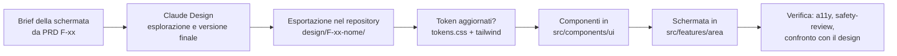

# Design e interfaccia

L'interfaccia di Noxa nasce in **Claude Design** e viene implementata in `apps/web` con
Tailwind (ADR-0011). Questo documento definisce il flusso tra design e codice, le regole del
design system e i requisiti di accessibilità. La procedura passo per passo è nella skill
`implement-design`.

## 1. Flusso dal design al codice

1. **Brief**: per ogni schermata si parte dalla funzionalità del PRD (ID, criteri di
   accettazione, regole di sicurezza collegate) e si scrive un brief in
   `design/F-xx-nome/brief.md` (il design system va in `design/sistema/`; il calendario delle
   cartelle per iterazione è in GUIDA_OPERATIVA.md §4) con: obiettivo, stati da disegnare (vuoto, caricamento,
   errore, successo, offline), varianti per minorenni e maggiorenni se diverse, testi.
2. **Claude Design**: si genera la schermata partendo dal design system di Noxa già presente
   in Claude Design, così token e componenti restano coerenti.
3. **Esportazione**: il materiale finale (link al progetto Claude Design, immagini delle
   schermate per ogni stato, codice o specifiche esportate) va in `design/F-xx-nome/`. Il
   codice esportato è un **riferimento**, non si copia direttamente in produzione: va
   riscritto con i componenti, i token e le convenzioni del progetto.
4. **Implementazione**: skill `implement-design`.

## 2. Design token

- Fonte di verità nel codice: `apps/web/src/styles/tokens.css` (variabili CSS), mappate nella
  configurazione di Tailwind 4, che sta nel CSS (`@theme inline` in `src/app/globals.css`).
  Le palette predefinite di Tailwind sono azzerate: le utility disponibili sono solo quelle
  dei token (`bg-superficie-1`, `text-testo-secondario`, `rounded-3`…). Nessun valore di
  colore, spaziatura o raggio scritto direttamente nei componenti.
- Origine: il foglio `design/sistema/noxa.css` del progetto Claude Design "Noxa — Design
  system" (accento A, arancio "lampione al sodio"). Le classi dei componenti stanno in
  `src/styles/componenti.css` e usano solo i token.
- Temi: scuro su `:root`, chiaro con `data-tema="chiaro"` su `<html>`, scelto nel Profilo e
  ricordato sul dispositivo; un elemento con `data-tema` applica il tema solo al suo
  contenuto (catalogo dei componenti).
- Font: Archivo (variabile, assi peso e larghezza) e IBM Plex Mono, serviti dall'app con
  Fontsource, senza richieste a Google Fonts (R-62).
- Foto dei locali (ADR-0018): la velatura `.velatura` di `src/styles/scopri.css` sfuma la foto
  nel colore di sfondo del tema, come nel layer "scopri" di Claude Design; i token
  `--colore-velo-foto` e `--colore-testo-su-foto` della prima versione sono stati tolti con
  l'iterazione 4.
- Token delle schermate di accesso, dal layer "accesso" del progetto Claude Design
  (design/F-10-accesso): `--tipo-titolo-accesso`, `--tipo-marchio`,
  `--tipo-larghezza-marchio`, `--movimento-passo`, `--spostamento-passo`. Le classi stanno in
  `src/styles/accesso.css`.
- Scopri, mappa e dettaglio evento, dal layer "scopri" (design/F-01-scopri, esportazione
  `noxa-scopri.css`): nessun token nuovo, classi in `src/styles/scopri.css` (copertine,
  scheda in evidenza, riga compatta, generi, amici che partecipano, selettore Mi interessa /
  Partecipo, link esterni, segnaposto della mappa e anteprima, foglio dei filtri).
- Token delle schermate degli amici, dal layer "amici" (design/F-11-amici): `--qr-sfondo`,
  `--qr-moduli`, `--qr-velo-testo` (il QR resta nero su bianco in entrambi i temi, per la
  lettura delle fotocamere), `--mirino-sfondo`, `--mirino-testo` (il mirino è l'immagine
  della fotocamera, sempre scuro), `--avatar-grande`. Classi in `src/styles/amici.css`.
- Categorie: `colore` (superfici, testo, accento, stato: successo, avviso, errore, info),
  `spazio` (scala di 4 px), `raggio`, `ombra`, `tipografia` (famiglie, scala, interlinea),
  `movimento` (durate e curve, con la versione ridotta).
- **Tema scuro come predefinito** (uso notturno), con tema chiaro completo; entrambi
  rispettano i contrasti del §4.
- Movimento: transizioni funzionali di 150–250 ms e ingressi espressivi di 700–900 ms con la
  curva `cubic-bezier(.2,.7,.2,1)` (titoli che salgono, contenuti dal sfocato al nitido,
  bagliore dell'intestazione, indicatore della barra che scorre). Nessuna animazione
  infinita; con `prefers-reduced-motion` solo dissolvenze brevi (ADR-0019,
  `src/styles/movimento.css`).
- Una modifica ai token si fa prima in Claude Design, poi in `tokens.css`, nella stessa PR.

## 3. Componenti e schermate

- Immagini degli eventi: la scheda in evidenza e il dettaglio mostrano la foto del locale,
  con una velatura costruita sul colore di sfondo del tema che garantisce il contrasto del
  testo (componente `Copertina`; se l'immagine non si carica vale il fondo tipografico); in mancanza della foto,
  il flyer approvato e poi il fondo tipografico (ADR-0018). L'accento del design system
  (arancio "lampione al sodio", esplorazione A) resta per azioni e stati attivi.

- `src/components/ui/`: componenti del design system (Pulsante, Campo, Scheda,
  SchedaEvidenza e RigaEvento, Copertina, Genere, AmiciPartecipano, SelettorePartecipazione,
  LinkEsterno, Calendario, Avviso, Foglio, Badge e Contatore, Avatar e GruppoAvatar, Interruttore,
  Segmenti, Schede, ElencoVuoto, Caricamento, ErroreConAzione, StrisciaOffline,
  PulsanteSegnala, Mappa, CampoPassword con i requisiti, CampoData con il calendario in un
  foglio, CasellaLunga per i consensi, IndicatorePassi e IndicatorePunti, RigaPersona,
  MenuAzioni (menu ⋯ con le frecce e Esc, che si apre verso l'alto vicino al fondo), Toast con
  azione e il suo fornitore unico, CodiceQr). Foglio e modale usano `<dialog>`: il browser gestisce focus, Esc e
  inerzia del resto della pagina. Le icone sono di Lucide, con tratto 1,75.
- `src/components/guscio/`: barra di navigazione delle cinque aree (Scopri, Organizza, Vivi,
  Ricorda, Profilo), link "Vai al contenuto", striscia offline, registrazione del service
  worker. Ognuno ha i test unitari e una pagina di esempio nel catalogo
  `src/app/catalogo/page.dev.tsx`, inclusa solo in sviluppo: `next.config` aggiunge l'estensione
  `dev.tsx` a `pageExtensions` solo quando `NODE_ENV=development` o `NOXA_CATALOGO=1` (build
  dei test e2e, che verificano il catalogo con axe), quindi la pagina non entra nella build di
  produzione; la CI lo controlla.
- `src/features/<area>/`: schermate e componenti specifici di una funzionalità. Le schermate
  di accesso (`src/features/account/`) condividono l'impaginazione `Schermata` (testa con
  "Indietro", titolo che sale parola per parola, piede fisso) e fanno entrare i blocchi
  all'apertura con `Entra`, non allo scorrimento: sono schermate brevi, già tutte in vista.
- Ogni schermata gestisce gli stati: caricamento, vuoto, errore (con un'azione per
  riprovare), offline, successo.

## 4. Accessibilità (WCAG 2.2 AA)

| Requisito | Regola |
|---|---|
| Contrasto | Testo normale ≥ 4,5:1, testo grande e componenti dell'interfaccia ≥ 3:1, in entrambi i temi |
| Aree di tocco | Almeno 44 × 44 px |
| Focus | Indicatore di focus visibile, ordine di tabulazione logico, nessuna trappola del focus nei fogli e nelle finestre modali |
| Lettori di schermo | Etichette accessibili per tutti i controlli; annunci `aria-live` per gli aggiornamenti in tempo reale (conferme della serata, stato del ritorno sicuro) |
| Movimento | `prefers-reduced-motion` rispettato ovunque, compreso il Wrapped |
| Testo | Ridimensionabile al 200% senza perdita di contenuto; lingua `it` dichiarata |
| Mappa | Ogni informazione della mappa è disponibile anche nell'elenco |
| Colore | Il colore non è mai l'unico modo per comunicare uno stato |
| Moduli | Errori associati al campo, descritti nel testo, con suggerimento di correzione |

Verifica: axe-core nei test Playwright di ogni schermata, più una prova manuale con VoiceOver
(iOS) e TalkBack (Android) per i percorsi principali prima di ogni rilascio.

## 5. Tono e testi

- Si usa il "tu", con un linguaggio diretto e amichevole e frasi brevi.
- Le regole di sicurezza si spiegano senza paternalismo: cosa succede e perché, in una frase.
- Nessun testo che spinga a bere, a spendere o a uscire più spesso (R-43).
- Nessun dark pattern: niente conferme colpevolizzanti ("No, non voglio divertirmi"), niente
  urgenze artificiali, opzioni di privacy presentate con lo stesso peso visivo delle altre.
- Per i minorenni non compaiono testi o icone che rimandano all'alcol (R-23, R-40).
- Tutti i testi stanno in `apps/web/src/lib/messaggi/it.ts`.

## 6. Schermate principali

| Area | Schermate | Funzionalità |
|---|---|---|
| Accesso | Benvenuto, Registrazione (con data di nascita), Verifica email, Accesso, Onboarding sicurezza (3 schermate) | F-10 |
| Scopri | Elenco eventi con filtri, Mappa, Dettaglio evento, Carica flyer, Stato dei miei flyer | F-01…F-06 |
| Organizza | Amici (elenco, richieste, ricerca, codice QR), Gruppi, Dettaglio gruppo, Serata di gruppo (chi c'è, biglietti, trasporto) | F-11…F-16 |
| Vivi | Check-in, Avvio ritorno sicuro, Ritorno in corso, Ritorno di un amico (mappa e stato), Allerta | F-20…F-22 |
| Ricorda | Tracker (elenco, nuova serata, dettaglio), Statistiche, Badge, Wrapped | F-30…F-33 |
| Profilo | Profilo, Impostazioni di privacy, Bloccati, Le mie segnalazioni, Esporta dati, Elimina account, Informativa | F-12, F-41, F-42 |
| Moderazione | Coda flyer, Coda duplicati, Coda segnalazioni, Dettaglio segnalazione, Locali e fonti | F-40 |
