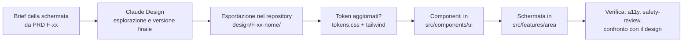

# Design e interfaccia

L'interfaccia di Noxa nasce in **Claude Design** e viene implementata in `apps/web` con
Tailwind (ADR-0011). Questo documento definisce il flusso tra design e codice, le regole del
design system e i requisiti di accessibilità. La procedura passo per passo è nella skill
`implement-design`.

## 1. Flusso dal design al codice

1. **Brief**: per ogni schermata si parte dalla funzionalità del PRD (ID, criteri di
   accettazione, regole di sicurezza collegate) e si scrive un brief in
   `design/F-xx-nome/brief.md` (il design system va in `design/sistema/`; il calendario delle
   cartelle per iterazione è in GUIDA_OPERATIVA.md §4) con: obiettivo, stati da disegnare (vuoto, caricamento,
   errore, successo, offline), varianti per minorenni e maggiorenni se diverse, testi.
2. **Claude Design**: si genera la schermata partendo dal design system di Noxa già presente
   in Claude Design, così token e componenti restano coerenti.
3. **Esportazione**: il materiale finale (link al progetto Claude Design, immagini delle
   schermate per ogni stato, codice o specifiche esportate) va in `design/F-xx-nome/`. Il
   codice esportato è un **riferimento**, non si copia direttamente in produzione: va
   riscritto con i componenti, i token e le convenzioni del progetto.
4. **Implementazione**: skill `implement-design`.

## 2. Design token

- Fonte di verità nel codice: `apps/web/src/styles/tokens.css` (variabili CSS), mappate nella
  configurazione di Tailwind 4, che sta nel CSS (`@theme inline` in `src/app/globals.css`).
  Le palette predefinite di Tailwind sono azzerate: le utility disponibili sono solo quelle
  dei token (`bg-superficie-1`, `text-testo-secondario`, `rounded-3`…). Nessun valore di
  colore, spaziatura o raggio scritto direttamente nei componenti.
- **Stile iOS (ADR-0035)**: dal 2026-11-19 il design system segue le Human Interface
  Guidelines di Apple (iOS 26, materiali tipo Liquid Glass), definito direttamente nel codice
  per deroga del product owner; il progetto Claude Design va riallineato. Le regole sono in
  §2.1. Le classi dei componenti stanno in `src/styles/componenti.css` e usano solo i token.
- Temi: **scuro predefinito** su `:root` anche con il sistema in chiaro; chiaro con
  `data-tema="chiaro"` su `<html>`, scelto con l'interruttore del Profilo e ricordato sul
  dispositivo; un elemento con `data-tema` applica il tema solo al suo contenuto (catalogo dei
  componenti).
- Font: carattere di sistema (`-apple-system`, SF Pro su Apple, Roboto su Android) con Inter
  variabile come ripiego; Archivo variabile solo per i momenti di marca
  (`--tipo-famiglia-marchio`, classe `.t-marchio`). Tutti serviti dall'app con Fontsource,
  senza richieste a Google Fonts (R-62).
- Foto dei locali (ADR-0018): la velatura `.velatura` di `src/styles/scopri.css` sfuma la foto
  nel colore di sfondo del tema, come nel layer "scopri" di Claude Design; i token
  `--colore-velo-foto` e `--colore-testo-su-foto` della prima versione sono stati tolti con
  l'iterazione 4.
- Larghezza del sito (ADR-0033): `--sito-larghezza`, `--sito-margine`, `--sito-max` per il
  layout desktop. La trasparenza diffusa del 2026-11-15 è sostituita dai materiali di §2.1.
- Token delle schermate di accesso, dal layer "accesso" del progetto Claude Design
  (design/F-10-accesso): `--tipo-titolo-accesso`, `--tipo-marchio`,
  `--tipo-larghezza-marchio`, `--movimento-passo`, `--spostamento-passo`. Le classi stanno in
  `src/styles/accesso.css`.
- Scopri, mappa e dettaglio evento, dal layer "scopri" (design/F-01-scopri, esportazione
  `noxa-scopri.css`): nessun token nuovo, classi in `src/styles/scopri.css` (copertine,
  scheda in evidenza, riga compatta, generi, amici che partecipano, selettore Mi interessa /
  Partecipo, link esterni, segnaposto della mappa e anteprima, foglio dei filtri).
- Token delle schermate degli amici, dal layer "amici" (design/F-11-amici): `--qr-sfondo`,
  `--qr-moduli`, `--qr-velo-testo` (il QR resta nero su bianco in entrambi i temi, per la
  lettura delle fotocamere), `--mirino-sfondo`, `--mirino-testo` (il mirino è l'immagine
  della fotocamera, sempre scuro), `--avatar-grande`. Classi in `src/styles/amici.css`.
- Categorie: `colore` (etichette, sfondi, celle, riempimenti, separatori, tinta, stato:
  successo, avviso, errore, info), `spazio` (griglia da 8 pt), `raggio`, `ombra`, `materiale`,
  `tipografia` (famiglie e scala Dynamic Type), `movimento` (durate, curve a molla, versione
  ridotta).
- Movimento: transizioni di 150–450 ms con curve a molla (`--curva-molla`,
  `--curva-molla-viva`); niente titoli che salgono parola per parola né sfocature d'ingresso
  (ADR-0035, che sostituisce le durate di ADR-0019). Transizioni di navigazione tra route con
  View Transitions API (dissolvenza con un leggero spostamento, 180/280 ms). Nessuna
  animazione infinita; con `prefers-reduced-motion` solo dissolvenze brevi
  (`src/styles/movimento.css`).
- Layout responsive (ADR-0022, ADR-0033): l'app è portrait-first ma funziona pienamente in
  landscape e su browser desktop. Tra **768 e 1023 px** la barra di navigazione è una sidebar
  sinistra (68 px, sole icone); a **≥ 1024 px** Noxa si presenta come un sito: barra in alto
  con marchio e aree, piè di pagina con i documenti, colonna centrata da 720 o 1120 px
  (`--larghezza-pagina`), Scopri a griglia, dettaglio evento a due colonne, Benvenuto largo.
  L'area di moderazione usa container query e si adatta a qualsiasi larghezza, compreso il
  portrait su tablet. Token di riferimento: `--bp-tablet` (768 px), `--bp-desktop` (1024 px),
  `--sidebar-stretta` (68 px), `--sidebar-larga` (200 px) in `tokens.css`.
- Una modifica ai token si fa prima in Claude Design, poi in `tokens.css`, nella stessa PR;
  per lo stile iOS di ADR-0035 la fonte è il codice finché Claude Design non è riallineato.

### 2.1 Stile iOS (ADR-0035)

| Ambito | Regola |
|---|---|
| Colori | Ruoli semantici di iOS: `--colore-etichetta` (+ `-secondaria`, `-terziaria`), `--colore-sfondo` (pagina raggruppata), `--colore-sfondo-secondario`/`-terziario`, `--colore-cella` (+ `-premuta`), `--colore-riempimento` (+ `-secondario`, `-terziario`), `--colore-separatore` (+ `-opaco`), `--colore-tinta` (+ `-premuta`, `-tenue`). I nomi storici (`--colore-superficie-*`, `--colore-testo-*`, `--colore-accento*`, `--colore-linea*`) sono alias: nei componenti nuovi si usano i ruoli iOS |
| Tinta | Ciano neon: `#3EE0CF` in scuro (12,8:1 sul nero), `#005A52` in chiaro (7,3:1 su `#F2F2F7`, almeno 4,6:1 sui riempimenti grigi dei pulsanti tinti). Una sola tinta: azioni principali, scheda attiva, interruttori accesi, link. Mai su più di una o due azioni per schermata |
| Sfondi | Scuro: pagina `#000000`, celle `#1C1C1E`, elevato `#2C2C2E`. Chiaro: pagina `#F2F2F7`, celle `#FFFFFF`. Il contenuto sta su superfici piene |
| Tipografia | Scala Dynamic Type in `rem` su base Body = 17 px: `--tipo-titolo-grande` 34, `--tipo-titolo-1` 28, `-2` 22, `-3` 20, `--tipo-titoletto` 17 semibold, `--tipo-corpo` 17, `--tipo-richiamo` 16, `--tipo-corpo-piccolo` 15, `--tipo-nota` 13, `--tipo-didascalia` 12, `--tipo-didascalia-2` 11 (minimo assoluto). Su iPhone e iPad la base è `-apple-system-body` e segue la dimensione del testo di sistema (`globals.css`). Classi `.t-titolo-grande`, `.t-titolo-1…3`, `.t-titoletto`, `.t-corpo`, `.t-richiamo`, `.t-corpo-s`, `.t-nota`, `.t-didascalia`, `.etichetta` (intestazione di sezione) |
| Spazi e raggi | Griglia da 8 pt (4 come mezzo passo), `--margine-schermo` 16 pt. Raggi: `--raggio-1` 6, `-2` 12 (campi, celle singole), `-3` 20 (schede e gruppi di celle), `-4` 26 (avvisi, schede grandi), `--raggio-foglio` 34, `--raggio-tondo` per pulsanti a capsula, segmenti e barra delle schede |
| Materiali | Solo nello strato funzionale che galleggia sul contenuto: barra delle schede, `.barra-titolo`, fogli, menu, avvisi, toast, barre delle azioni, pulsanti sopra le foto (`.materiale` per i nuovi). Token `--materiale-sottile/-normale/-spesso`, `--sfocatura-*`, `--materiale-bordo`. Mai su schede, celle, campi o contenitori di contenuto. Ripieghi opachi in `vetro.css` senza `backdrop-filter`, con `prefers-reduced-transparency` e con `prefers-contrast: more` (che alza anche i bordi a 3:1) |
| Navigazione | Telefono: barra delle schede a capsula di vetro che galleggia sopra l'indicatore di Home, icona attiva piena e tinta, capsula che scivola a molla. Il fondo occupato è `--nav-ingombro`: le barre delle azioni fisse si appoggiano lì. Titolo grande (`IntestazioneArea`) che scorrendo lascia il posto a `.barra-titolo` di vetro con il titolo piccolo. Tablet e desktop come ADR-0022 e ADR-0033 |
| Componenti | Pulsanti a capsula: `principale` pieno, `secondario` tinto grigio, `testo` semplice, `neutro`, `pericolo` tinto rosso. Liste raggruppate `.gruppo` > `.gruppo-titolo`, `.gruppo-celle` > `.cella` (con `.cella-testo`, `.cella-dettaglio`, `.cella-freccia`, `.cella-icona`), separatori rientrati. Segmented control (`Segmenti`, `Schede`). Interruttore 51 × 31 con il segno di spunta. Campo di ricerca `.campo-ricerca`. Fogli con maniglia che si trascinano per chiudere (`Foglio`). Scheletri con un riflesso che scorre tre volte. Stati vuoti centrati con simbolo grande |
| Movimento | Durate `--movimento-veloce` 150, `-base` 250, `-lento` 350, `-molla` 450 ms. Pressione: `scale(0.96)`. Fogli che salgono a molla, avvisi che entrano leggermente ingranditi. La schermata di apertura e i momenti di Ricorda possono durare di più, una volta |
| Sicurezza delle aree | Barre e fogli rispettano `env(safe-area-inset-*)` (notch, Dynamic Island, indicatore di Home) |
| Marchio | Nessun logo, nome o asset Apple: si imita lo stile, non l'identità. Icone Lucide a tratto 1,75 |

## 3. Componenti e schermate

- Immagini degli eventi: la scheda in evidenza e il dettaglio mostrano la foto del locale,
  con una velatura costruita sul colore di sfondo del tema che garantisce il contrasto del
  testo (componente `Copertina`; se l'immagine non si carica vale il fondo tipografico); in mancanza della foto,
  il flyer approvato e poi la **copertina generata** della serata (design/F-01-copertine-generate):
  motivo astratto dal seme titolo + locale (`src/lib/copertinaGenerata.ts`), colori letti
  dall'immagine della fonte (`copertina_colori`, ADR-0030) o, se mancano, la famiglia del primo
  genere (token `--copertina-*` in `tokens.css`, classi in `src/styles/copertine.css`); testo
  sempre su velatura del fondo, contrasto ≥ 12,7:1. Il fondo tipografico resta solo per le
  copertine sostitutive (ADR-0023). L'accento del design system
  (la tinta ciano neon di ADR-0035) resta per azioni e stati attivi.

- Rinfresco dell'interfaccia (`design/F-01-rinfresco-interfaccia/brief.md`), implementato su
  richiesta del product owner direttamente nel codice con i soli token esistenti, senza tavole
  di Claude Design: Benvenuto con le quattro promesse dell'app su copertine generate di
  esempio (nessun evento reale); in Scopri miniature più grandi, riga degli amici subito sotto
  l'orario e fila «Con i tuoi amici» in cima (`SchedaAmici`: solo amici confermati con la
  scelta visibile, R-67; non ripete l'evento in evidenza e non compare con il filtro «solo
  eventi con amici»); «Partecipo» in accento tenue a riposo e pieno quando è scelto, con un
  battito singolo dopo il tocco; fondo tenue dietro l'icona dell'area attiva e luna per Vivi.
  Le tavole di `design/F-01-scopri/` e `design/F-10-accesso/` restano il riferimento per
  tutto il resto; il progetto Claude Design va riallineato a queste modifiche.
- Schermata di apertura (`src/components/guscio/Apertura.tsx`, classi in `movimento.css`): alla
  prima pagina di ogni sessione compare solo il simbolo: la «n» sale e il lampione si accende
  con il bagliore, poi la schermata si apre sulla pagina sotto in 2 s. Solo CSS, non intercetta i tocchi, nascosta ai lettori di
  schermo; non compare con `prefers-reduced-motion` né nelle pagine successive (lo script del
  tema la segna come vista nel `sessionStorage`, mai sul server).

- Foto d'atmosfera (ADR-0032): la copertina generata mostra una foto di pubblico dominio o
  CC0 scelta dal seme della serata tra i temi del genere (`src/lib/fotoSerata.ts`, elenco con
  le licenze in `fotoSerata.json`, file in `public/copertine/`), in bianco e nero sotto la
  tinta dei colori della serata (`.cg-foto`, `.cg-tinta` in `copertine.css`); il motivo
  disegnato resta solo se la foto non si carica.

- Pagina 404 (`src/app/not-found.tsx`) con il ritorno a Scopri; anteprima dei link condivisi
  (Open Graph) con `public/icone/anteprima.png`, generata con le icone da
  `pnpm --filter web icone`; `public/robots.txt` lascia ai motori solo le pagine pubbliche.

- `src/components/ui/`: componenti del design system (Pulsante, Campo, Scheda,
  SchedaEvidenza e RigaEvento, Copertina, Genere, AmiciPartecipano, SelettorePartecipazione,
  LinkEsterno, Calendario, Avviso, Foglio (con trascinamento per chiudere), Badge e Contatore, Avatar e GruppoAvatar, Interruttore,
  Segmenti, Schede, ElencoVuoto, Caricamento, ErroreConAzione, StrisciaOffline,
  PulsanteSegnala, Mappa, CampoPassword con i requisiti, CampoData con il calendario in un
  foglio, CasellaLunga per i consensi, IndicatorePassi e IndicatorePunti, RigaPersona,
  MenuAzioni (menu ⋯ con le frecce e Esc, che si apre verso l'alto vicino al fondo), Toast con
  azione e il suo fornitore unico, CodiceQr). Foglio e modale usano `<dialog>`: il browser gestisce focus, Esc e
  inerzia del resto della pagina. Le icone sono di Lucide, con tratto 1,75.
- `src/components/guscio/`: barra di navigazione delle cinque aree (Scopri, Organizza, Vivi,
  Ricorda, Profilo), link "Vai al contenuto", striscia offline, registrazione del service
  worker. Ognuno ha i test unitari e una pagina di esempio nel catalogo
  `src/app/catalogo/page.dev.tsx`, inclusa solo in sviluppo: `next.config` aggiunge l'estensione
  `dev.tsx` a `pageExtensions` solo quando `NODE_ENV=development` o `NOXA_CATALOGO=1` (build
  dei test e2e, che verificano il catalogo con axe), quindi la pagina non entra nella build di
  produzione; la CI lo controlla.
- `src/features/<area>/`: schermate e componenti specifici di una funzionalità. Le schermate
  di accesso (`src/features/account/`) condividono l'impaginazione `Schermata` (testa con
  "Indietro", titolo grande, piede fisso) e fanno entrare i blocchi
  all'apertura con `Entra`, non allo scorrimento: sono schermate brevi, già tutte in vista.
- Il link "indietro" delle pagine interne (`LinkIndietro` e `useIndietro` in
  `src/components/guscio/Indietro.tsx`) riporta alla pagina dell'app da cui si è arrivati,
  come il gesto indietro del telefono, e ne mostra il nome; solo senza una pagina precedente
  (indirizzo aperto da fuori, notifica) porta alla pagina madre. La pila degli indirizzi
  visitati resta nel `sessionStorage` della scheda (`src/lib/navigazione.ts`), mai sul server.
- Ogni schermata gestisce gli stati: caricamento, vuoto, errore (con un'azione per
  riprovare), offline, successo.

## 4. Accessibilità (WCAG 2.2 AA)

| Requisito | Regola |
|---|---|
| Contrasto | Testo normale ≥ 4,5:1, testo grande e componenti dell'interfaccia ≥ 3:1, in entrambi i temi |
| Aree di tocco | Almeno 44 × 44 px (controlli disegnati più piccoli, come segmenti e interruttori, allargano l'area con uno pseudo-elemento) |
| Focus | Indicatore di focus visibile, ordine di tabulazione logico, nessuna trappola del focus nei fogli e nelle finestre modali |
| Lettori di schermo | Etichette accessibili per tutti i controlli; annunci `aria-live` per gli aggiornamenti in tempo reale (conferme della serata, stato del ritorno sicuro) |
| Movimento | `prefers-reduced-motion` rispettato ovunque, compreso il Wrapped |
| Trasparenza e contrasto | `prefers-reduced-transparency` e `prefers-contrast: more` rendono pieni i materiali; con il contrasto aumentato separatori e bordi passano a 3:1 |
| Dimensione del testo | Su iPhone e iPad il testo segue Dynamic Type; nessun testo sotto gli 11 pt |
| Testo | Ridimensionabile al 200% senza perdita di contenuto; lingua `it` dichiarata |
| Mappa | Ogni informazione della mappa è disponibile anche nell'elenco |
| Colore | Il colore non è mai l'unico modo per comunicare uno stato |
| Moduli | Errori associati al campo, descritti nel testo, con suggerimento di correzione |

Verifica: axe-core nei test Playwright di ogni schermata, eseguiti su Chrome, Safari su iPhone
(WebKit) e Firefox, più una prova manuale con VoiceOver (iOS) e TalkBack (Android) per i
percorsi principali prima di ogni rilascio. Su Safari va provata a mano anche la resa sotto le
barre del browser, che i test non riproducono.

## 5. Tono e testi

- Si usa il "tu", con un linguaggio diretto e amichevole e frasi brevi.
- Le regole di sicurezza si spiegano senza paternalismo: cosa succede e perché, in una frase.
- Nessun testo che spinga a bere, a spendere o a uscire più spesso (R-43).
- Nessun dark pattern: niente conferme colpevolizzanti ("No, non voglio divertirmi"), niente
  urgenze artificiali, opzioni di privacy presentate con lo stesso peso visivo delle altre.
- Per i minorenni non compaiono testi o icone che rimandano all'alcol (R-23, R-40).
- Tutti i testi stanno in `apps/web/src/lib/messaggi/it.ts`.

## 6. Schermate principali

| Area | Schermate | Funzionalità |
|---|---|---|
| Accesso | Benvenuto, Registrazione (con data di nascita), Verifica email, Accesso, Onboarding sicurezza (3 schermate) | F-10 |
| Scopri | Elenco eventi con filtri, Mappa, Dettaglio evento, Carica flyer, Stato dei miei flyer | F-01…F-06 |
| Organizza | Amici (elenco, richieste, ricerca, codice QR), Gruppi, Dettaglio gruppo, Serata di gruppo (chi c'è, biglietti, trasporto) | F-11…F-16 |
| Vivi | Check-in, Avvio ritorno sicuro, Ritorno in corso, Ritorno di un amico (mappa e stato), Allerta | F-20…F-22 |
| Ricorda | Tracker (elenco, nuova serata, dettaglio), Statistiche, Badge, Wrapped | F-30…F-33 |
| Profilo | Profilo, Impostazioni di privacy, Bloccati, Le mie segnalazioni, Esporta dati, Elimina account, Informativa | F-12, F-41, F-42 |
| Moderazione | Coda flyer, Coda duplicati, Coda segnalazioni, Dettaglio segnalazione, Locali e fonti | F-40 |
