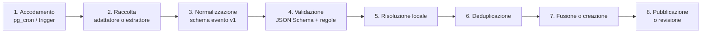

# Raccolta degli eventi

Questo documento descrive come Noxa costruisce il catalogo degli eventi: fonti, pipeline,
formato dei dati, estrazione dai flyer, deduplicazione e fusione. Le regole legali sulle fonti
sono in ADR-0008; quelle di sicurezza (età minima, alcol) in
[SAFETY_PRIVACY.md](SAFETY_PRIVACY.md) §5.

## 1. Approccio: si parte dai locali

Il catalogo si costruisce **a partire dai locali**, non dagli eventi: si mantiene un elenco
curato di locali dell'area e, per ognuno, le sue fonti. Questo approccio:

- limita la raccolta ai luoghi realmente rilevanti;
- dà un `locale_id` certo a quasi tutti gli eventi, che è la chiave principale della
  deduplicazione;
- permette di verificare la conformità fonte per fonte.

## 2. Fonti

### 2.1 Elenco dei locali (bootstrap)

1. **OpenStreetMap** con l'API Overpass: `amenity=nightclub` (più `amenity=bar` e
   `amenity=events_venue` con `club=*` o `music_venue=*`, da verificare a mano) nelle aree
   amministrative `ISO3166-2=IT-MI` e `ISO3166-2=IT-MB`. Si salvano `osm_id`, nome,
   coordinate, indirizzo, sito web e contatti presenti nei tag.
2. **Google Places** (Text Search: "discoteca", "club", "locale notturno" nelle stesse
   province) **solo per scoprire candidati** da verificare a mano. Dai risultati di Google si
   conserva solo il `place_id` (`locali.google_place_id`), come consentito dai termini di
   Google Maps Platform; gli altri dati del locale si inseriscono dopo la verifica manuale,
   da OSM o dal sito ufficiale.
3. **Pulizia manuale** nell'area di moderazione: unione dei doppioni OSM/Google, verifica che
   il locale sia attivo, aggiunta di sito web, username Instagram e pagine sugli aggregatori,
   creazione delle righe in `fonti` con `stato_conformita = 'da_verificare'`.

Lo script di bootstrap è `services/worker/src/noxa_worker/fonti/bootstrap_locali.py`
(`uv run python -m noxa_worker.fonti.bootstrap_locali --csv candidati.csv [--importa]`):
interroga Overpass per le due province e Google Places (Text Search con
`X-Goog-FieldMask: places.id`, quindi solo identificativi) con `ClientHttpConforme`, scrive
un CSV da rivedere e, con `--importa`, inserisce i candidati nuovi in `candidati_locali`
segnalando il possibile doppione (locale entro 200 m o con lo stesso nome normalizzato). Non
scrive mai in `locali`: i candidati si verificano nell'area di moderazione ("Verifica e
crea", "Unisci", "Scarta" con motivazione).

### 2.2 Tipi di fonte

| Tipo (`tipo_fonte`) | Adattatore | Stato nel MVP | Note |
|---|---|---|---|
| `sito_locale` | `sito_jsonld` | Fase 1 | Legge dati strutturati schema.org `Event` (JSON-LD o microdata) e feed iCal se presenti. È il primo da provare per ogni sito. |
| `sito_locale` | `sito_html_<locale>` | Fase 1 | Adattatore specifico per un sito senza dati strutturati: estende `AdattatoreSitoHtml` (`fonti/sito_html.py`) dichiarando i selettori CSS; il primo si scrive per un locale verificato in staging. Playwright solo se la pagina richiede JavaScript. |
| `instagram` | `instagram_business_discovery` | Fase 1 | Instagram Graph API, endpoint Business Discovery, solo per account Business o Creator. |
| `resident_advisor`, `xceed`, `dice` | `aggregatore_<nome>` | Fase 3 | Solo con accordo scritto o API ufficiale (D-05). Fino ad allora `stato_conformita = 'vietata'`. |
| *(flyer)* | estrattore flyer | Fase 1 | Caricati dagli utenti; non sono righe di `fonti` (§5). |

### 2.3 Verifica di conformità di una fonte

Prima di attivare una fonte, un moderatore compila `note_conformita` con:

1. l'esito di robots.txt per i percorsi che verranno letti, con `User-agent: NoxaBot` e `*`;
2. i termini d'uso del sito: assenza di divieti di raccolta automatica o di riuso dei dati
   (con il link e la data della lettura);
3. la frequenza prevista e il numero massimo di pagine per esecuzione;
4. i campi raccolti: solo quelli dello schema (§3.3).

Solo dopo può impostare `stato_conformita = 'consentita'` e `attiva = true` (vincolo nel
database). La procedura completa è nella skill `add-event-source`.

### 2.4 Regole operative per lo scraping

| Regola | Valore |
|---|---|
| User agent | `NoxaBot/1.0 (+https://noxa.app/bot)`: la pagina spiega chi siamo e come chiedere la rimozione |
| robots.txt | Letto per ogni dominio e anche a ogni redirect (cache di 24 ore); un percorso vietato interrompe la fonte con `ErroreConformita` senza fare la richiesta. Come RFC 9309: 404 = nessuna regola, 401 e 403 = tutto vietato, errore del server = la fonte non si legge in questa esecuzione. `Crawl-delay` più lungo di 5 secondi viene rispettato. Le API ufficiali con chiave (Graph API, Places, Overpass) non leggono robots.txt ma hanno gli stessi limiti |
| Frequenza | Al massimo 1 richiesta ogni 5 secondi per dominio; un solo job per dominio alla volta (`coda_job.chiave_concorrenza`) |
| Volume | Al massimo 50 pagine per esecuzione; esecuzione ogni 6 ore o meno spesso |
| Cache | `ETag` e `If-Modified-Since` quando supportati |
| Errori | Con 429 o 403 la fonte si ferma per quell'esecuzione: niente nuovi tentativi immediati. Il backoff è nella pianificazione: dopo ogni errore l'intervallo raddoppia (fino a 8 volte la frequenza). Dopo 5 errori consecutivi viene disattivata (`disattivata_automaticamente_il`) e il worker registra l'allarme `fonte_disattivata` |
| Vietato | Login, aggiramento di CAPTCHA o paywall, rotazione di IP o di user agent per eludere blocchi, raccolta di dati personali (commenti, partecipanti, foto di persone) |
| Immagini | Non si scaricano né si ripubblicano immagini dai siti o da Instagram: si salva solo il link alla fonte. Le foto dei locali arrivano solo da fonti lecite, caricate dai moderatori (ADR-0018) |
| Fonte | Ogni evento mostra sempre il link alla pagina originale (`eventi_fonti.url_originale`) |
| Rimozione | Una richiesta di rimozione del titolare del sito viene eseguita entro 72 ore: fonte disattivata e `stato_conformita = 'vietata'` |

### 2.5 Instagram

- Si usa solo l'**Instagram Graph API** di Meta con l'endpoint **Business Discovery**, che
  permette all'account professionale di Noxa di leggere i metadati e i media pubblici di altri
  account Business o Creator. Nessuno scraping, nessun accesso a storie o account personali.
- Chiamata per locale (frequenza ≥ 12 ore):
  `GET /{ig-user-id}?fields=business_discovery.username(<username>){media.limit(20){id,caption,media_type,media_url,permalink,timestamp}}`
- I post degli ultimi 14 giorni vengono analizzati. Dall'iterazione 5 la didascalia si legge
  con regole (`fonti/didascalie.py`): data, ora, titolo (prima riga significativa senza
  hashtag), line-up; età, alcol e generi dalla didascalia e dagli hashtag. Un post senza data
  o senza ora non diventa un evento. Con l'estrattore dei flyer (iterazione 6) la didascalia
  passerà all'estrattore in modalità testo e, se non basta, l'immagine (`media_url`) in
  modalità immagine, senza salvarla. Fino ad allora la richiesta chiede solo
  `id, caption, permalink, timestamp`.
- Il token sta nell'intestazione `Authorization`, mai nell'URL, così non finisce nei log.
- `url_originale` = `permalink` del post.
- Prerequisiti (Fase 0, ROADMAP.md): app Meta, account Instagram professionale di Noxa
  collegato a una pagina Facebook, App Review approvata per i permessi richiesti da Business
  Discovery, token di sistema conservato solo nel worker.
- Gli account dei locali non Business o Creator non sono raggiungibili: per loro restano i
  flyer caricati dagli utenti.

## 3. Pipeline



### 3.1 Passi

1. **Accodamento**: `pg_cron` inserisce `esegui_fonte` per le fonti attive con
   `ultima_esecuzione_il + frequenza_minuti < now()`; il trigger su `caricamenti_flyer`
   inserisce `analizza_flyer`.
2. **Raccolta**: l'adattatore restituisce una lista di `EventoGrezzo` (dizionari fedeli alla
   fonte) e l'URL di ognuno. Nessuna scrittura nel database dentro l'adattatore.
3. **Normalizzazione**: conversione nel formato del §3.3. Date nel fuso `Europe/Rome`
   convertite in ISO 8601 con offset; generi mappati sui codici di `generi_musicali` (tabella
   di sinonimi in `normalizzazione/generi.py`); età minima estratta da espressioni come "14+",
   "dai 16 anni", "18 anni compiuti", "over 21"; `riferimenti_alcol` impostato se compaiono
   termini dell'elenco `normalizzazione/alcol.py` (open bar, drink incluso, nomi di marchi di
   alcolici, "shot", "free drink" e simili).
4. **Validazione**: JSON Schema (`packages/schemas/evento.schema.json`) più regole: `inizio`
   entro i prossimi 180 giorni e non più di 12 ore nel passato; `fine` successiva a `inizio`
   e non oltre 24 ore dopo; titolo non vuoto dopo la normalizzazione. Un grezzo non valido va
   in `eventi_grezzi` con `stato = 'errore'` e il motivo.
5. **Risoluzione del locale**: per le fonti è il `locale_id` della fonte; per i flyer si
   confronta il nome estratto con `locali.nome_normalizzato` (rapidfuzz `WRatio` ≥ 90) e,
   se il flyer riporta un indirizzo o un comune, si restringe ai locali di quel comune. Se
   nessun locale supera la soglia, il grezzo va in revisione con "locale non riconosciuto".
6. **Deduplicazione**: §6.
7. **Fusione o creazione**: §7.
8. **Pubblicazione**: un evento nuovo da fonte `consentita` è `pubblicato`; da flyer è
   `in_revisione` (R-51).

Prima della deduplicazione un grezzo con lo stesso identificativo esterno di un evento già
raccolto dalla **stessa fonte** è un aggiornamento di quell'evento: si fonde direttamente
(§7), con le stesse regole sulle modifiche rilevanti. Gli eventi passati o oltre 180 giorni
diventano grezzi `scartato`, gli altri dati non validi `errore`; in entrambi i casi il
payload conserva solo URL, identificativo, titolo e inizio.

"Esegui ora" su una fonte consentita ma non attiva è una **prova**: il worker legge, normalizza
e deduplica, conta l'esito in `esecuzioni_fonte` e `fonti.ultimo_esito`, ma non scrive
grezzi né eventi e non sposta la pianificazione.

### 3.2 Idempotenza

- `eventi_grezzi.hash_contenuto` (SHA-256 del payload normalizzato senza `raccolto_il`) è
  unico per fonte: la stessa pagina riletta senza modifiche non produce lavoro.
- Per i flyer si calcola l'hash percettivo dell'immagine (pHash): un'immagine quasi identica
  a una già analizzata negli ultimi 30 giorni riusa il risultato senza chiamare il modello.
- I job hanno `chiave_idempotenza` (DATA_MODEL.md, `coda_job`).

### 3.3 Formato JSON dell'evento (schema v1)

Il contratto è `packages/schemas/evento.schema.json` (JSON Schema 2020-12), condiviso tra
worker (modelli Pydantic generati o scritti a mano e verificati in CI contro lo schema) e
app (tipi TypeScript generati). Esempio:

```json
{
  "versione_schema": 1,
  "origine": {
    "tipo": "sito_locale",
    "fonte_id": "5f0c2a6e-3b8e-4f0e-9a51-2a1d7a9c1b10",
    "caricamento_flyer_id": null,
    "url": "https://www.esempio-club.it/eventi/sabato-techno",
    "id_esterno": "evt-2026-10-17",
    "raccolto_il": "2026-10-12T14:03:22+02:00"
  },
  "locale": {
    "id": "a3d9b9a0-8a3b-4b8e-9f3e-1c2d3e4f5a6b",
    "nome": "Esempio Club",
    "comune": "Milano"
  },
  "titolo": "Sabato Techno con DJ Esempio",
  "descrizione": "Line-up completa sul sito del locale.",
  "inizio": "2026-10-17T23:30:00+02:00",
  "fine": "2026-10-18T05:00:00+02:00",
  "eta_minima": 18,
  "riferimenti_alcol": false,
  "generi": ["techno"],
  "artisti": ["DJ Esempio"],
  "prezzo_min_centesimi": 1500,
  "url_biglietti": "https://www.esempio-club.it/biglietti",
  "estrazione": null
}
```

| Campo | Obbligatorio | Note |
|---|---|---|
| `versione_schema` | sì | intero; una modifica incompatibile incrementa il valore e richiede una migrazione dei grezzi |
| `origine.tipo` | sì | `sito_locale`, `instagram`, `resident_advisor`, `xceed`, `dice`, `flyer` |
| `origine.fonte_id` / `origine.caricamento_flyer_id` | uno dei due | |
| `origine.url` | sì tranne che per `flyer` | link mostrato all'utente |
| `locale.id` | no | null finché il locale non è risolto (passo 5) |
| `locale.nome` | sì | |
| `titolo` | sì | 1–200 caratteri |
| `inizio` | sì | ISO 8601 con offset |
| `fine` | no | |
| `eta_minima` | no | 14–30; `null` = non indicata, diventa 18 (R-21) |
| `riferimenti_alcol` | sì | |
| `generi` | sì | da 0 a 5 codici di `generi_musicali` |
| `artisti` | sì | da 0 a 20 nomi |
| `prezzo_min_centesimi`, `url_biglietti`, `descrizione` | no | |
| `estrazione` | solo per flyer e Instagram | `{ "modello", "versione_prompt", "confidenza": 0–1, "confidenza_campi": {…}, "anno_inferito": bool }` |

## 4. Interfaccia degli adattatori

Ogni adattatore è una classe in `services/worker/src/noxa_worker/fonti/` registrata in
`fonti/registro.py` con il nome usato in `fonti.adattatore`.

```python
class Adattatore(Protocol):
    nome: ClassVar[str]
    tipo: ClassVar[TipoFonte]

    async def raccogli(self, fonte: Fonte, http: ClientHttpConforme) -> list[EventoGrezzo]:
        """Legge la fonte e restituisce gli eventi trovati, senza scrivere nel database.

        Solleva ErroreConformita se robots.txt o i limiti lo impediscono,
        ErroreFonte per errori di rete o di struttura della pagina.
        """

    def normalizza(self, grezzo: EventoGrezzo, fonte: Fonte) -> EventoNormalizzato:
        """Converte un grezzo nello schema v1. Solleva ErroreValidazione se mancano dati."""
```

`ClientHttpConforme` incapsula httpx (e Playwright quando serve) e applica in un solo posto
user agent, robots.txt, limitazione della frequenza, cache e timeout: gli adattatori non
possono fare richieste in altro modo (regola verificata in revisione e da un test che vieta
l'import diretto di `httpx` e `playwright` nei moduli degli adattatori).

## 5. Estrazione dai flyer

1. L'app rimuove l'EXIF, ridimensiona a un lato massimo di 2048 px e carica l'immagine in
   `flyer-caricati/<utente_id>/<uuid>.<ext>`, poi inserisce la riga in `caricamenti_flyer`.
2. Il trigger accoda `analizza_flyer`. Il worker scarica l'immagine, rimuove di nuovo l'EXIF,
   la ridimensiona al lato massimo `FLYER_LATO_MAX_PX` (predefinito 1568), calcola il pHash
   (§3.2) e controlla il budget giornaliero.
3. Chiamata a Claude API con il prompt versionato e lo schema Pydantic `FlyerEstratto`
   (ADR-0007, skill `flyer-parser`):
   - `client.messages.parse(..., output_format=FlyerEstratto)`, con l'immagine come blocco
     `image` in base64 e nessun dato dell'utente nella richiesta (R-66);
   - il modello restituisce `e_un_evento`, i campi dell'evento, `confidenza` per campo,
     `anno_inferito` e `contenuto_inappropriato`;
   - il testo presente nell'immagine è trattato come dato, mai come istruzione: il prompt lo
     dichiara e l'output è vincolato allo schema.
4. Esiti:
   - `e_un_evento = false` → `stato = 'rifiutato'` con motivo "l'immagine non sembra un
     flyer di un evento";
   - `contenuto_inappropriato = true` → `in_revisione` con priorità alta e immagine nascosta;
   - risposta `refusal` o errore di validazione → `errore`, visibile in moderazione;
   - altrimenti → normalizzazione (passo 3 del §3.1) e deduplicazione.
5. Se il grezzo corrisponde a un evento già `pubblicato` (punteggio ≥ 90, §6.3), il
   caricamento diventa `unito`: si aggiunge una riga in `eventi_fonti` e i campi non vengono
   modificati (R-51). Altrimenti si crea l'evento `in_revisione` e il caricamento passa a
   `in_revisione`.
6. In moderazione il revisore vede flyer ed estrazione affiancati. I campi con confidenza
   sotto 0,7 hanno il segno «da controllare», e la stessa soglia vale per il filtro
   «Confidenza bassa» della coda (`SOGLIA_CONFIDENZA_BASSA` in
   `apps/web/src/features/moderazione/Flyer.tsx`). Il revisore corregge, imposta
   `riferimenti_alcol` (scelta sempre esplicita, mai precompilata) ed `eta_minima`, poi
   approva (l'evento diventa `pubblicato` e l'immagine, se adatta, viene copiata in
   `flyer-pubblicati` dal job `copia_immagine_flyer` del worker) o rifiuta con motivo.

## 6. Deduplicazione

### 6.1 Normalizzazione dei testi

`normalizza_titolo(titolo, locale)`:

1. Unicode NFKD, rimozione degli accenti, minuscole.
2. Rimozione di punteggiatura ed emoji; spazi multipli ridotti a uno.
3. Rimozione dei token non distintivi: nome del locale e sue varianti, giorni della settimana,
   mesi, numeri che rappresentano date o orari, e le parole dell'elenco
   `dedup/parole_vuote.py` (`party`, `night`, `serata`, `presents`, `pres`, `feat`, `ft`,
   `special`, `guest`, `free`, `entry`, `ingresso`, `omaggio`, `lista`, `w`, `with`, `x`,
   `vol`, `edition`, `ed`).
4. Il risultato vuoto viene sostituito dal titolo dopo il solo passo 1 e 2.

`normalizza_artista(nome)`: passi 1 e 2, più la rimozione dei prefissi `dj`, `mc`, `b2b`.

### 6.2 Blocchi di confronto

Si confrontano solo eventi dello stesso blocco:

- **con locale noto**: stesso `locale_id` e stessa `data_serata` (data di `inizio - 6 ore`
  nel fuso `Europe/Rome`: un evento che inizia all'01:00 appartiene alla sera precedente);
- **senza locale noto** (solo flyer in revisione): eventi con locale entro 150 m dalle
  coordinate del comune o con nome del locale simile (`WRatio` ≥ 80) e stessa `data_serata`.

Gli eventi `rifiutato` e `annullato` sono esclusi dai candidati.

### 6.3 Punteggio e decisione

Per ogni candidato:

- `s_titolo` = `rapidfuzz.fuzz.token_set_ratio(titolo_norm_a, titolo_norm_b)` (0–100);
- `artisti_comuni` = numero di artisti normalizzati in comune;
- `delta_inizio` = differenza assoluta tra gli orari di inizio, in minuti (infinita se uno
  dei due manca).

| Condizione | Decisione |
|---|---|
| `s_titolo ≥ 90` | **stesso evento** |
| `75 ≤ s_titolo < 90` e (`artisti_comuni ≥ 1` oppure `delta_inizio ≤ 60`) | **stesso evento** |
| `75 ≤ s_titolo < 90` senza le condizioni sopra | **revisione** (`in_revisione_dedup`) |
| `s_titolo < 75`, entrambi sono l'unico evento del blocco e (`artisti_comuni ≥ 1` oppure `delta_inizio ≤ 90`) | **revisione** |
| altrimenti | **eventi distinti** |

Se più candidati superano la soglia si sceglie prima quello che si unisce da solo, poi quello
con `s_titolo` più alto; a parità, quello con `delta_inizio` minore.

**Eccezione per i flyer**: un grezzo da flyer viene unito automaticamente solo con
`s_titolo ≥ 90` (prima riga della tabella). Nei casi della seconda riga va in revisione,
perché un flyer non verificato non deve poter agganciarsi da solo a un evento pubblicato
(R-51).

Le soglie sono in `dedup/configurazione.py` e si calibrano sul dataset
`services/worker/tests/dati/dedup_golden.jsonl` (almeno 300 coppie, estese con ogni errore
trovato in produzione). La prima versione (350 coppie) è costruita da
`tests/dati/genera_dedup_golden.py` con locali, titoli e artisti di fantasia e le varianti
tipiche delle fonti, compresi casi difficili (titoli che condividono parole, titoli
riscritti); con le soglie attuali dà precisione 100% e richiamo 94,7%. Le coppie decise in
moderazione si aggiungono in fondo al file. Obiettivi: precisione ≥ 98% sulle decisioni
"stesso evento", richiamo ≥ 90%. Il test `test_dedup_golden.py` fallisce se una modifica li
peggiora.

### 6.4 Revisione dei duplicati

I grezzi `in_revisione_dedup` compaiono nella coda di moderazione con l'evento candidato
affiancato e il motivo ("Stesso locale, orario a 30 minuti, titolo simile", "Modifica
rilevante: inizio spostato di 3 ore"). Il moderatore sceglie "stesso evento" (fusione, §7,
comprese le modifiche rilevanti) o "eventi distinti" (creazione) con la RPC
`decidi_duplicato`, che registra la decisione e accoda il job `deduplica_grezzo`: è il worker
ad applicarla. Ogni decisione viene aggiunta al dataset di calibrazione con un'esportazione
periodica.

## 7. Fusione

Quando un grezzo è lo stesso evento di un evento esistente:

| Campo | Regola |
|---|---|
| `titolo`, `descrizione`, `inizio`, `fine`, `prezzo_min_centesimi`, `url_biglietti` | valore della fonte più affidabile tra quelle che lo forniscono: `sito_locale` (4) > `instagram` (3) > aggregatori (2) > `flyer` (1). A parità vince il dato raccolto più di recente. |
| `eta_minima` | **massimo** tra i valori dichiarati dalle fonti (R-22); `eta_minima_dichiarata = true` se almeno una fonte la dichiara. Se nessuna fonte la dichiara resta 18. Un valore dichiarato già salvato non viene mai abbassato dalla pipeline (trigger `private.proteggi_eta_evento`). |
| `riferimenti_alcol` | OR logico tra le fonti |
| `generi` | unione, al massimo 5, ordinati per frequenza tra le fonti |
| `artisti` | unione normalizzata, al massimo 20 |
| `ultima_verifica_il` | `now()` |

Un evento `pubblicato` non viene mai riportato a `in_revisione` da una fusione. Le modifiche
a `inizio` superiori a 2 ore o a `locale_id` vengono applicate solo da un moderatore
(il grezzo va in `in_revisione_dedup` con la nota "modifica rilevante").

Un evento non più presente nella sua unica fonte per due esecuzioni consecutive, a più di 48
ore dall'inizio, viene segnalato in moderazione come "possibile annullamento"; non viene
annullato in automatico. Il conteggio è `eventi_fonti.assenze_consecutive`, aggiornato dopo
ogni esecuzione riuscita che ha letto almeno un evento (una pagina vuota non conta come
assenza di tutti gli eventi).

Una correzione del moderatore verso il basso (età o alcol) resta finché la fonte non cambia
pagina: se la fonte modificata dichiara di nuovo un'età più alta o l'alcol, la fusione li
ripristina. È la direzione prudente (R-22).

## 8. Qualità e monitoraggio

- Per ogni esecuzione di una fonte: pagine lette, grezzi prodotti, nuovi eventi, fusioni,
  errori; salvati in `fonti.ultimo_esito` e nei log.
- Allarme se una fonte attiva produce 0 eventi per 3 esecuzioni consecutive (probabile
  cambiamento della struttura del sito).
- Ogni mese si controllano a mano 100 eventi pubblicati (metrica del PRD §2).
- L'estrazione dai flyer si valuta sul golden set (skill `flyer-parser`) a ogni modifica di
  prompt, schema o modello.
